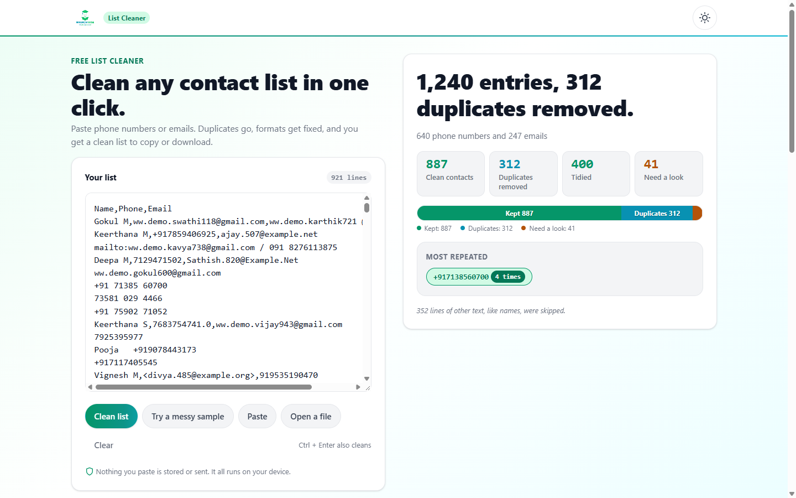
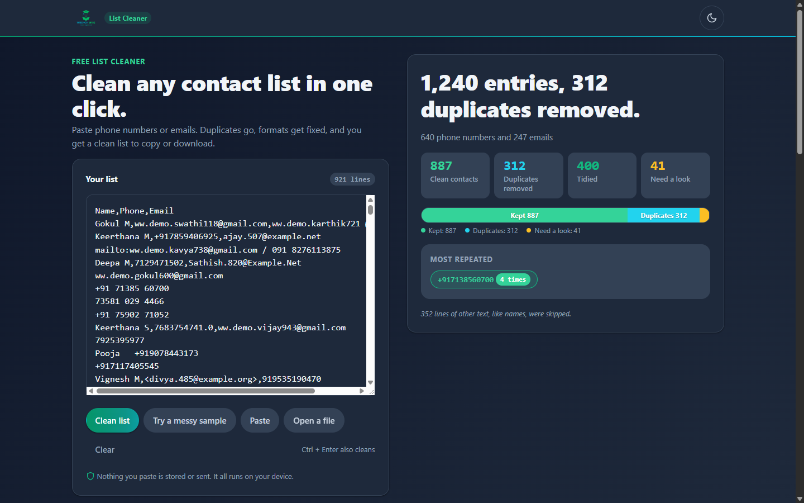
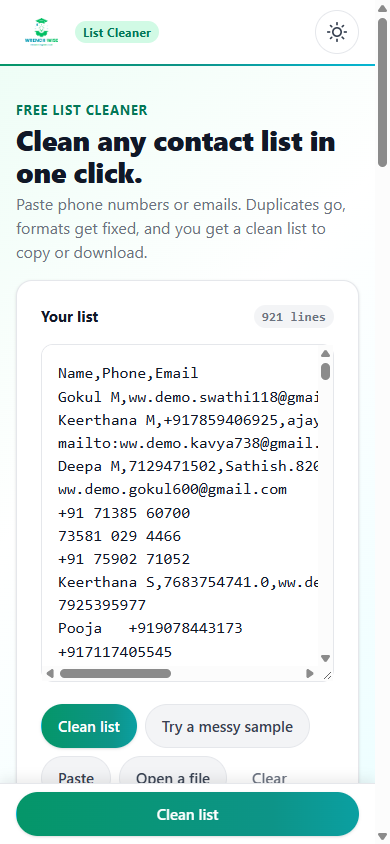
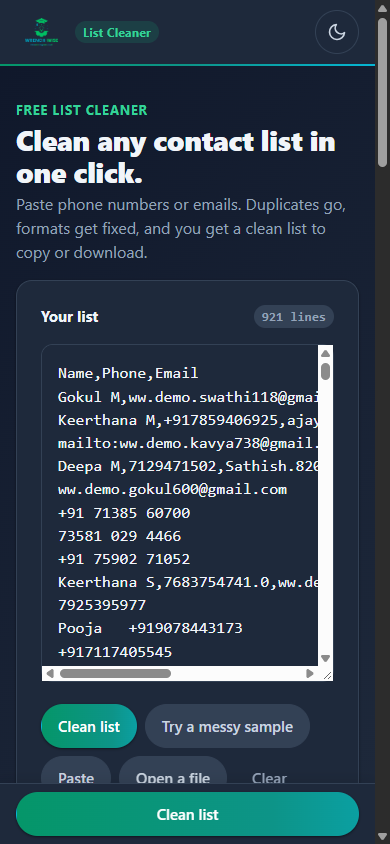

# List Cleaner: Complete Project Documentation

This document explains every detail of the List Cleaner project. It is written in plain English with short sentences so that anyone can understand, use, explain, test, deploy, and rebuild this software from scratch without prior technical experience.

---

## 1. Quick Summary

**Project Name:** List Cleaner (Wrench Wise)

List Cleaner is a fast, privacy-first web application that cleans messy lists of phone numbers and email addresses in one click. It automatically deletes duplicate contacts, fixes broken formatting, sorts the list, and lets users copy or download the clean results without sending any personal data over the internet.

### Project Fact Table

| Fact | Value | Location in Project |
| :--- | :--- | :--- |
| Project Name | List Cleaner | config.js, Line 2; index.html, Line 7 |
| Parent Brand | Wrench Wise | js/copy.js, Line 5; config.js, Line 19 |
| Application Version | 1.0.0 | config.js, Line 4 |
| Total Project Files | 31 files (28 text files, 3 image assets, plus 4 generated screenshots) | Project Root |
| Total Text Lines of Code | 5,423 lines | All text files combined |
| JavaScript Code Lines | 2,736 lines (14 files) | js/ and config.js |
| CSS Style Lines | 1,745 lines (4 files) | styles/ |
| HTML Lines | 201 lines (1 file) | index.html |
| Markdown Documentation Lines | 492 lines (2 files) | README.md, PROJECT_BRIEF.md |
| Configuration and Data Lines | 249 lines (4 files) | package.json, vercel.json, manifest.json, .gitignore, tools/verify.mjs |
| Sample Data Size | 1,240 messy contact entries | js/sample-data.js, SAMPLE_TEXT |
| Clean Contacts from Sample | 887 unique contacts | js/engine/cleaner.js, cleanList |
| Duplicates Removed from Sample | 312 duplicate entries | js/engine/cleaner.js, cleanList |
| Tidied Contacts from Sample | 400 entries with formatting fixed | js/engine/cleaner.js, cleanList |
| Invalid Entries from Sample | 41 entries requiring manual review | js/engine/cleaner.js, cleanList |
| Skipped Lines from Sample | 352 non-contact text lines | js/engine/cleaner.js, cleanList |
| Maximum Text Character Limit | 4,000,000 characters | js/engine/cleaner.js, MAX_CHARS |
| Maximum Input Entries Limit | 100,000 entries | js/engine/cleaner.js, MAX_ENTRIES |
| Screen Preview Rows Cap | 500 rows | config.js, previewRows |
| Maximum File Upload Size | 4 megabytes (MB) | config.js, maxFileMB |
| Live Website Address | https://listcleaner-mu.vercel.app/ | config.js, siteUrl; index.html, Line 16 |
| Automated Test URL | https://listcleaner-mu.vercel.app/?test=1 | js/selftest.js, runSelfTest |
| Git Repository URL | https://github.com/Pradeep-B28/List_Cleaner.git | .git/config, remote origin |
| Active Git Branch | main | Git repository |
| Last Update Commit | 9c83bbb (November 6, 2026) | Git log |
| Author | B Pradeep (pradeepbashaa@gmail.com) | README.md, Line 5; Git log |

---

## 2. Purpose

### The Problem It Solves
People who manage lead lists, customer contact databases, recruitment sheets, or event registrations frequently copy contact information from spreadsheets, emails, and chat messages. These lists are almost always messy:
1. Phone numbers are written in dozens of different ways, such as `+91 98400 12345`, `098400-12345`, `(984) 001-2345`, or `919840012345`.
2. Spreadsheets like Microsoft Excel often damage large numbers by adding decimal points (such as `9840012345.0`) or converting them into scientific notation (such as `9.84E+09`).
3. People paste lists with duplicate entries, names, extra words, and typing errors like `gmial.com`.
4. Most existing online list cleaning websites send the pasted data to remote cloud servers. This violates customer privacy, risks data leaks, and breaks data protection laws.

List Cleaner solves this entire problem by standardizing formats, removing duplicates, and classifying broken entries instantly inside the web browser.

### Who It Is For
1. **Sales and Marketing Teams:** Professionals who need to clean raw contact leads before importing them into Customer Relationship Management (CRM) databases or WhatsApp broadcast tools.
2. **Human Resources and Recruiters:** Recruiters who receive large batches of applicant phone numbers and email addresses.
3. **Office Administrators and Operations Staff:** Workers who regularly handle Excel exports and need clean lists without learning complex spreadsheet formulas.
4. **Students and Learners:** Beginners who want to see how real computer science data structures work in an intuitive web tool.

### Why It Was Built
1. To provide a zero-trust, 100% private utility tool that mathematically guarantees contact data never leaves the visitor's local computer or phone.
2. To demonstrate practical Data Structures and Algorithms (known as DSA in computer science) solving a real-world business problem at 60 frames per second using pure vanilla JavaScript without external libraries.
3. To showcase high-performance frontend engineering principles: strict Content Security Policy, zero layout shifts, zero framework overhead, and accessible design.

### Connected Wrench Wise Program
This web application connects directly to the **Certification Program in AI-Powered Software Engineering & DSA** offered by Wrench Wise (config.js, program.name; js/sections-ui.js, renderSections). The Call To Action (CTA) section at the bottom of the page invites students to learn the underlying algorithms (hash sets and merge sort) used to build this software.

---

## 3. How to Open It

### Live Deployment Link
The project is hosted live on the internet at:
[https://listcleaner-mu.vercel.app/](https://listcleaner-mu.vercel.app/) (config.js, siteUrl).

The live automated self-test suite can be viewed directly at:
[https://listcleaner-mu.vercel.app/?test=1](https://listcleaner-mu.vercel.app/?test=1) (js/main.js, Line 153).

### Step-by-Step Guide to Run It Locally on a Laptop

Running this project requires no compiler, no build step, and no installation of complex software packages. Because the code uses modern JavaScript ECMAScript (ES) modules, web browsers require the files to be served through an HTTP server rather than opened as a local file link.

1. **Check for Node.js or Python:** Open your laptop terminal (PowerShell or Command Prompt on Windows, or Terminal on macOS or Linux). Check if Node.js is installed by typing `node -v`. If not installed, check for Python by typing `python --version`.
2. **Download or Clone the Code:** Download the project files or run the Git clone command in your terminal:
   `git clone https://github.com/Pradeep-B28/List_Cleaner.git`
3. **Enter the Project Folder:** Type `cd List_Cleaner` and press Enter.
4. **Start a Local Server:**
   - If using Node.js, run: `npx --yes serve .`
   - If using Python, run: `python -m http.server 3000`
5. **Open Your Web Browser:** Open Google Chrome, Microsoft Edge, Mozilla Firefox, or Apple Safari.
6. **Navigate to the Local Address:** Type `http://localhost:3000` into your browser address bar and press Enter. The application will immediately load.

### Special Link Options (Query Parameters)

| Query Parameter | Full Link Example | What It Does | Where It Lives |
| :--- | :--- | :--- | :--- |
| `?test=1` | `http://localhost:3000/?test=1` | Automatically runs the 10-point self-test suite over the live DOM after page load. It runs the sample data, inspects the count-up headline, verifies DSA metrics, checks memory isolation, tests CSP blocking, and displays a floating results card showing PASS or FAIL for every check. | js/main.js, Line 153; js/selftest.js, runSelfTest |
| None (Default) | `http://localhost:3000/` | Opens the standard interactive application with the first-visit animation loader, ready for contact cleaning. | js/main.js, DOMContentLoaded |

---

## 4. Every Screen and Every Feature

### Screen Overview
List Cleaner is built as a responsive single-page application. It adapts smoothly between desktop computers, laptops, tablets, and mobile phones without reloading the page or shifting layout components.

```
+-------------------------------------------------------------------------------+
| SITE HEADER: Logo | List Cleaner Badge | Theme Toggle (Light/Dark)            |
+-------------------------------------------------------------------------------+
| HERO SECTION                                                                  |
|   Left Column:                               Right Column:                    |
|   - Eyebrow and Main Title                   - Headline Count-Up              |
|   - Subtitle Description                     - Phone and Email Breakdown      |
|   - Input Card:                              - 4 Interactive Stat Tiles       |
|     * Textarea with live line counter        - Stacked Proportion Bar         |
|     * Scan sweep animation line              - Merge Moment (Top repeat chip) |
|     * 5 Action buttons                       - Notice notes (Skipped/Capped)  |
|     * Privacy badge note                                                      |
+-------------------------------------------------------------------------------+
| OUTPUT PANEL SECTION (Appears after cleaning)                                 |
|   [ Clean list (active) ] [ Duplicates ] [ Tidied ] [ Need a look ]           |
|   - Format Pills (+91, Spaced, Plain 10-digit, WhatsApp)                      |
|   - Filter Pills (All, Phones, Emails)                                        |
|   - Sort Order Pills (A to Z, As pasted)                                      |
|   - Separator Pills (New lines, Commas)                                       |
|   - Monospace Preview Box (Up to 500 lines)                                   |
|   - Action Buttons: [Copy] [Download CSV] [Download TXT]                     |
+-------------------------------------------------------------------------------+
| PRIVACY STRIP: Zero-trust guarantee, airplane mode test instructions          |
+-------------------------------------------------------------------------------+
| DSA SECTION: Standard Form, Hash Set (O(1)), Merge Sort (O(N log N))          |
+-------------------------------------------------------------------------------+
| THREE HABITS: Best practices for clean spreadsheets                           |
+-------------------------------------------------------------------------------+
| CTA SECTION: Explore Wrench Wise Certification Program                        |
+-------------------------------------------------------------------------------+
| FOOTER: Branding and privacy disclaimer                                       |
+-------------------------------------------------------------------------------+
```

---

### Feature 1: First-Visit Session Loader
- **What It Does:** Greets first-time visitors in a browsing session with a sleek, 800-millisecond brand introduction.
- **What the Person Sees:** A centered modal card showing the Wrench Wise logo, three horizontal colored list lines that slide into one line with an animated checkmark tick, and a thin green gradient progress bar.
- **How It Works in Code:** Checks whether `lc-intro-seen` exists in `sessionStorage` or if the user enabled reduced motion (js/motion.js, initLoader). If not seen, it plays the keyframe animation for 800 milliseconds, fades out in 250 milliseconds, marks `lc-intro-seen` as `1`, and raises the hero section into view by 12 pixels. If JavaScript is disabled or fails, a pure CSS animation failsafe removes the loader after 2,000 milliseconds (styles/motion.css, Line 15).

---

### Feature 2: Input Card and Line Counter
- **What It Does:** Accepts pasted text, typed entries, or uploaded text files, and maintains a real-time line count.
- **What the Person Sees:** A dedicated card on the left side of the screen containing an input label, a monospace text area with placeholder instructions, a live pill counter showing `0 lines`, and five action buttons.
- **How It Works in Code:**
  1. Listening to the `input` event on the `#list` text area calculates line breaks using `text.split(/\r\n|\r|\n/).length` and updates `#line-count` using Indian numbering grouping (js/input-ui.js, updateLineCount).
  2. On mobile screens, when the line count is greater than zero, a floating bottom action bar appears with a prominent "Clean list" button (js/input-ui.js, Line 57).

---

### Feature 3: Action Buttons (Input Controls)
1. **Clean List Button:** Primary button styled with a multi-tone emerald gradient. Clicking it immediately triggers text cleaning (js/input-ui.js, Line 89).
2. **Try a Messy Sample Button:** Loads a pre-built messy list of 1,240 synthetic entries into the text area, flashes the box, updates the line count to `1,240 lines`, and automatically executes the cleaning engine (js/input-ui.js, Line 103).
3. **Paste Button:** Reads clipboard contents directly using the browser's asynchronous Clipboard API (`navigator.clipboard.readText()`), loads the text into the box, and runs cleaning (js/input-ui.js, Line 114). If the user or browser denies clipboard access, it displays a polite floating warning notice advising manual pasting via Ctrl + V (js/copy.js, input.pasteBlocked).
4. **Open a File Button:** Triggers a hidden file selector input accepting `.csv` and `.txt` files (js/input-ui.js, Line 135). It verifies that file size does not exceed the 4 MB limit (config.js, maxFileMB), reads the text using a `FileReader` object, places the contents into the box, and cleans immediately.
5. **Clear Button:** Smoothly fades out the text box in 180 milliseconds, resets the text area value to empty, sets the line count back to `0 lines`, resets the result card to its default empty illustration, and hides the output panel (js/input-ui.js, Line 174; js/result-ui.js, renderEmpty).

---

### Feature 4: Scan Sweep Micro-Interaction
- **What It Does:** Provides visual feedback that the software is actively scanning the list.
- **What the Person Sees:** A luminous emerald gradient beam sweeps downward from the top to the bottom of the text box over 450 milliseconds, while a bright shine reflection glides across the Clean list button.
- **How It Works in Code:** Synchronously executes `cleanList()`, triggers CSS classes `.scanning` and `.shine` for 450 milliseconds, and displays the populated results immediately as the beam reaches the bottom (js/motion.js, triggerScan). If the user prefers reduced motion, the scan animation is skipped entirely.

---

### Feature 5: Result Card and Headline Count-Up
- **What It Does:** Presents a clear, high-level summary of the cleaning process.
- **Empty State:** Shows a hand-drawn SVG vector graphic representing disorganized lines passing through a directional arrow and emerging as neatly aligned, ticked rows (index.html, Line 134).
- **Populated State:**
  1. **Headline:** A large bold title (40px on laptop, 28px on mobile) stating the total entries and duplicates removed, such as `1,240 entries, 312 duplicates removed.` (js/result-ui.js, Line 49).
  2. **Count-Up Animation:** Over 700 milliseconds, numbers smoothly roll from 0 up to their final values using a cubic ease-out mathematical curve (js/motion.js, countUpHeadline).
  3. **Split Subtitle:** A secondary description displaying exact contact types, such as `640 phone numbers and 247 emails` (js/copy.js, result.split).
  4. **Polite Screen Reader Announcement:** Emits the exact headline text into a hidden `aria-live="polite"` DOM region for visually impaired users without repeating sensitive contact data (js/result-ui.js, Line 54).

---

### Feature 6: Interactive Stat Tiles
- **What It Does:** Breaks down the cleaning results into four clickable metric cards.
- **The Four Tiles:**
  1. **Clean contacts (Kept):** Shows count of valid, deduplicated contacts (e.g. `887`). Colored in emerald green `#059669`. Clicking opens the Clean list tab.
  2. **Duplicates removed:** Shows count of redundant entries removed (e.g. `312`). Colored in cyan-teal `#0891B2`. Clicking opens the Duplicates tab.
  3. **Tidied:** Shows count of entries whose formatting was corrected (e.g. `400`). Colored in emerald green. Clicking opens the Tidied tab.
  4. **Need a look (Invalid):** Shows count of unfixable or invalid entries (e.g. `41`). Colored in amber-orange `#B45309`. Clicking opens the Need a look tab.
- **How It Works in Code:** Renders as accessible `<button>` elements with ARIA labels (js/result-ui.js, Line 80). Each tile staggers into view with a 40-millisecond sequential delay and counts up from 0 (styles/motion.css, Line 204).

---

### Feature 7: Stacked Ratio Bar
- **What It Does:** Visualizes the proportional composition of the processed list in a single horizontal bar.
- **What the Person Sees:** A rounded bar divided into three colored sections: Kept (green), Duplicates (teal), and Need a look (amber). When a segment is 12% or wider, its text label and count are displayed directly inside the bar. A detailed legend sits beneath the bar.
- **How It Works in Code:** Computes percentages against `counts.total` (js/result-ui.js, Line 122). Each segment scales from `scaleX(0)` to `scaleX(1)` with an 85% overshoot to create an elastic physical feel (styles/motion.css, Line 233).

---

### Feature 8: Merge Moment Animation
- **What It Does:** Visually proves how duplicate variations were unified into one contact.
- **What the Person Sees:** A dedicated card titled "MOST REPEATED". It displays the various raw ways the contact was found (for example `+91 90581 88589`, `9058188589`, and `09058188589`) as separate gray pill chips. The chips smoothly slide together, disappear, and pop out as a single formatted green pill accompanied by a dark green badge reading `4 times`.
- **How It Works in Code:** Inspects `result.repeats[0]` (js/result-ui.js, Line 202). If the visitor has reduced motion enabled, it renders directly in its final merged state without motion (js/result-ui.js, Line 224).

---

### Feature 9: Output Panel: Clean List Tab
- **What It Does:** Lets users customize, inspect, copy, and export their cleaned contacts.
- **Phone Format Selector:** Four pill buttons to reformat phone numbers on the fly:
  1. `+919840012345` (International E.164: best for CRM systems).
  2. `+91 98400 12345` (Spaced: easiest for humans to read).
  3. `9840012345` (Plain 10-digit: safest for Microsoft Excel).
  4. `919840012345` (WhatsApp format: prefix without plus sign).
  Selecting a pill instantly updates the preview list and saves the preference in `localStorage` under `lc-format` (js/output-ui.js, Line 209).
- **Show Filter:** Three pills to filter output rows: `All`, `Phones`, or `Emails`.
- **Sort Order:** Two pills: `A to Z` (alphabetical and numerical merge sort) or `As pasted` (original appearance order).
- **Separator:** Two pills: `New lines` (one contact per line) or `Commas` (comma-separated string).
- **Preview Box:** High-performance monospace list displaying up to 500 rows inside a `DocumentFragment`. If the list exceeds 500 rows, a footer note clarifies: `Showing the first 500 of 887. Copy or download to get all of them.` (js/output-ui.js, Line 482).
- **Export Actions:**
  1. **Copy Button:** Copies all cleaned contacts into the system clipboard. The button icon morphs into a checkmark and the label changes to `Copied` for 1.5 seconds (js/output-ui.js, Line 507).
  2. **Download CSV Button:** Generates an RFC-compliant CSV file named `clean-list.csv` using a client-side memory `Blob`. The download icon bounces downward into its tray on click (js/output-ui.js, Line 541).
  3. **Download TXT Button:** Generates a plain text file named `clean-list.txt` using a memory `Blob` (js/output-ui.js, Line 564).

---

### Feature 10: Detail Tabs (Duplicates, Tidied, Need a Look)
- **Duplicates Tab:** Displays up to 200 repeated contacts sorted by frequency. Each row displays the primary contact, a `{count} times` badge, and pill chips showing every raw way it was written in the pasted text (js/details-ui.js, Line 8). If any Gmail address was deduplicated, an informational callout box explains that Gmail ignores dots and plus signs (js/details-ui.js, Line 26).
- **Tidied Tab:** Displays up to 200 contacts in a two-column comparison table showing the "Before" raw text and "After" standardized contact (js/details-ui.js, Line 92).
- **Need a Look Tab:** Displays up to 200 invalid items that could not be verified. Each row shows the raw text, an amber warning badge stating the reason code (such as "Too few digits" or "Damaged by Excel"), and an explanation of why it failed (js/details-ui.js, Line 160).

---

### Feature 11: Privacy Strip Section
- **What It Does:** Explains the cryptographic and architectural privacy guarantees of the tool.
- **What the Person Sees:** A full-width card with an SVG shield icon titled "Check it yourself". It explains that visitors can disconnect their internet or turn on airplane mode, and the software will continue operating perfectly because nothing is sent to a server (js/sections-ui.js, Line 16).

---

### Feature 12: DSA "Under the Hood" Educational Section
- **What It Does:** Teaches the Computer Science concepts powering the engine.
- **The Three Cards:**
  1. **Standard Form First:** Explains lexical normalization, showing how three different formats resolve to one canonical key before checking duplicates (js/sections-ui.js, Line 62).
  2. **Hash Set:** Explains constant time O(1) lookups. After cleaning, it displays live statistics: `Your list needed 1,199 lookups. Comparing every pair would take 7,18,201 comparisons.` (js/sections-ui.js, Line 75).
  3. **Sorting:** Explains divide-and-conquer merge sort. After cleaning, it displays live comparison counts: `Sorting your list took 7,602 comparisons.` (js/sections-ui.js, Line 93).

---

### Feature 13: Three Habits Section
- **What It Does:** Provides actionable spreadsheet hygiene advice for non-technical workers.
- **The Three Habits:**
  1. Keep phone numbers in one column, with +91 (js/copy.js, tips.one).
  2. Format phone columns as Text in Excel to avoid scientific notation damage (js/copy.js, tips.two).
  3. Clean every list before uploading it to any email or CRM software (js/copy.js, tips.three).

---

### Feature 14: Call to Action (CTA) Section
- **What It Does:** Connects the educational experience to Wrench Wise career training.
- **What the Person Sees:** A high-contrast card with an emerald top border titled "Want to build tools like this?". It invites students to enroll in the Certification Program in AI-Powered Software Engineering & DSA.
- **Action Buttons:**
  1. `Explore the program`: Opens the official Wrench Wise program link in a new tab with UTM campaign parameters (js/links.js, getProgramLink).
  2. `Talk to us on WhatsApp`: Opens a pre-filled WhatsApp conversation when configured in `config.js` (js/links.js, getWhatsAppLink).

---

### Laptop versus Phone Differences

| Aspect | Laptop Screen (1024px and wider) | Mobile Phone Screen (390px wide) | Location in Code |
| :--- | :--- | :--- | :--- |
| Layout Structure | Two-column hero grid (input on left, result on right). | Single-column stacked layout (heading, input card, result card, output panel). | styles/components.css, Line 106 |
| Text Area Height | Fixed 360 pixels tall. | Proportional 40vh (minimum 220px tall). | styles/components.css, Line 202 |
| Clean Button Trigger | Standard button inside the input card row. | Dual triggers: standard button plus a fixed bottom sticky bar. | styles/components.css, Line 1164 |
| Shortcut Hint | Displays `Ctrl + Enter also cleans`. | Hidden to save screen space. | styles/components.css, Line 325 |
| Post-Clean Action | Remains in place; results render side by side. | Automatically scrolls smoothly down to the result card. | js/main.js, Line 53 |
| Stat Tiles Grid | 4 columns in a single row. | 2 columns by 2 rows grid. | styles/components.css, Line 421 |
| Control Groups | Horizontal rows with aligned labels. | Vertical stacked groups. | styles/components.css, Line 718 |
| Tab Bar | Horizontal row. | Horizontally scrollable bar with hidden scrollbars. | styles/components.css, Line 652 |


---

## 5. Every Control

This table catalogs every interactive element in the user interface, its exact visual label, its function, and where it sits on screen.

| Element ID / Selector | Control Type | Visual Label | What It Does | Screen Position | Code Location |
| :--- | :--- | :--- | :--- | :--- | :--- |
| `.skip-link` | Anchor link | `Skip to input` | Moves keyboard focus directly into the text box for screen reader and keyboard accessibility. | Top left, visible on focus | index.html, Line 30; styles/base.css, Line 31 |
| `#brand-logo` / `.brand-wrapper` | Link | `Wrench Wise` (Image + Text) | Opens the primary Wrench Wise website in a new browser tab. | Header, left side | index.html, Line 54; styles/components.css, Line 29 |
| `#theme-toggle` | Button | Sun / Moon Icon | Switches the application between Light theme and Dark theme, and persists choice in `localStorage`. | Header, right side | index.html, Line 60; js/main.js, Line 72 |
| `#list` | Text area | Placeholder text | Primary text entry box for typing or pasting contacts. | Input card, middle | index.html, Line 100; styles/components.css, Line 201 |
| `#btn-clean` | Primary button | `Clean list` | Triggers the scan animation and executes contact deduplication and formatting. | Input card button row, first button | index.html, Line 111; js/input-ui.js, Line 88 |
| `#btn-clean-mobile` | Primary button | `Clean list` | Triggers cleaning from the mobile sticky bottom bar when text is present. | Fixed bottom bar on mobile screens | index.html, Line 184; js/input-ui.js, Line 95 |
| `#btn-sample` | Secondary button | `Try a messy sample` | Loads the 1,240-entry sample list, pulses the box, and executes cleaning. | Input card button row, second button | index.html, Line 112; js/input-ui.js, Line 102 |
| `#btn-paste` | Secondary button | `Paste` | Reads text from the system clipboard into the box and runs cleaning. | Input card button row, third button | index.html, Line 113; js/input-ui.js, Line 113 |
| `#btn-open` | Secondary button | `Open a file` | Opens the operating system file picker to load a `.csv` or `.txt` file. | Input card button row, fourth button | index.html, Line 114; js/input-ui.js, Line 135 |
| `#file-input` | Hidden file input | None (Hidden) | Native file input element handling `.csv` and `.txt` file parsing. | Hidden from view | index.html, Line 115; js/input-ui.js, Line 140 |
| `#btn-clear` | Ghost button | `Clear` | Clears all text, resets counts, and returns the screen to the empty state. | Input card button row, fifth button | index.html, Line 116; js/input-ui.js, Line 174 |
| `Ctrl + Enter` / `Cmd + Enter` | Keyboard shortcut | `Ctrl + Enter also cleans` | Executes the clean action directly from the keyboard without clicking. | Keyboard listener on `#list` | index.html, Line 117; js/input-ui.js, Line 79 |
| `.stat-tile` (Clean) | Button tile | `Clean contacts` | Navigates directly to the Clean list tab in the output panel. | Result card, first stat tile | js/result-ui.js, Line 80; styles/components.css, Line 432 |
| `.stat-tile` (Duplicates) | Button tile | `Duplicates removed` | Navigates directly to the Duplicates tab in the output panel. | Result card, second stat tile | js/result-ui.js, Line 80; styles/components.css, Line 432 |
| `.stat-tile` (Tidied) | Button tile | `Tidied` | Navigates directly to the Tidied tab in the output panel. | Result card, third stat tile | js/result-ui.js, Line 80; styles/components.css, Line 432 |
| `.stat-tile` (Need a look) | Button tile | `Need a look` | Navigates directly to the Need a look tab in the output panel. | Result card, fourth stat tile | js/result-ui.js, Line 80; styles/components.css, Line 432 |
| `#tab-clean` | Tab button | `Clean list` | Activates the Clean list output panel showing the preview and export buttons. | Output panel tab bar, first tab | js/output-ui.js, Line 98; styles/components.css, Line 665 |
| `#tab-duplicates` | Tab button | `Duplicates` | Activates the Duplicates detail panel showing repeated items and variant chips. | Output panel tab bar, second tab | js/output-ui.js, Line 98; styles/components.css, Line 665 |
| `#tab-fixed` | Tab button | `Tidied` | Activates the Tidied comparison table showing Before and After values. | Output panel tab bar, third tab | js/output-ui.js, Line 98; styles/components.css, Line 665 |
| `#tab-invalid` | Tab button | `Need a look` | Activates the Need a look panel showing unfixable entries and diagnostic reasons. | Output panel tab bar, fourth tab | js/output-ui.js, Line 98; styles/components.css, Line 665 |
| Arrow Left / Right | Keyboard shortcut | None | Navigates between active tabs following W3C accessible tablist specifications. | Focused tab list | js/output-ui.js, Line 122 |
| `.pill-btn` (Format: e164) | Pill button | `+919840012345` | Formats all phone numbers to international standard with country code and no spaces. | Output panel controls, phone format group | js/output-ui.js, Line 203; styles/components.css, Line 744 |
| `.pill-btn` (Format: spaced) | Pill button | `+91 98400 12345` | Formats phone numbers with country code and a space separating five digits. | Output panel controls, phone format group | js/output-ui.js, Line 203; styles/components.css, Line 744 |
| `.pill-btn` (Format: plain) | Pill button | `9840012345` | Formats phone numbers as pure 10-digit integers without prefixes. | Output panel controls, phone format group | js/output-ui.js, Line 203; styles/components.css, Line 744 |
| `.pill-btn` (Format: wa) | Pill button | `919840012345` | Formats phone numbers with country code prefix but without the plus sign. | Output panel controls, phone format group | js/output-ui.js, Line 203; styles/components.css, Line 744 |
| `.pill-btn` (Filter: all) | Pill button | `All` | Displays both phone numbers and email addresses in the output list. | Output panel controls, show group | js/output-ui.js, Line 246; styles/components.css, Line 744 |
| `.pill-btn` (Filter: phones) | Pill button | `Phones` | Filters output to display phone numbers only. | Output panel controls, show group | js/output-ui.js, Line 246; styles/components.css, Line 744 |
| `.pill-btn` (Filter: emails) | Pill button | `Emails` | Filters output to display email addresses only. | Output panel controls, show group | js/output-ui.js, Line 246; styles/components.css, Line 744 |
| `.pill-btn` (Order: sorted) | Pill button | `A to Z` | Sorts output list in ascending alphabetical and numerical order via merge sort. | Output panel controls, order group | js/output-ui.js, Line 280; styles/components.css, Line 744 |
| `.pill-btn` (Order: asPasted) | Pill button | `As pasted` | Preserves the original chronological order of contacts as they appeared in input. | Output panel controls, order group | js/output-ui.js, Line 280; styles/components.css, Line 744 |
| `.pill-btn` (Sep: lines) | Pill button | `New lines` | Separates contacts with standard newline characters (`\n`). | Output panel controls, separator group | js/output-ui.js, Line 314; styles/components.css, Line 744 |
| `.pill-btn` (Sep: commas) | Pill button | `Commas` | Separates contacts with a comma and space (`, `). | Output panel controls, separator group | js/output-ui.js, Line 314; styles/components.css, Line 744 |
| `#btn-copy` | Primary button | `Copy` | Copies the entire formatted output list to the system clipboard. | Output panel action buttons row | js/output-ui.js, Line 358; styles/components.css, Line 284 |
| `#btn-download-csv` | Secondary button | `Download CSV` | Generates and downloads `clean-list.csv` from local memory. | Output panel action buttons row | js/output-ui.js, Line 377; styles/components.css, Line 298 |
| `#btn-download-txt` | Secondary button | `Download TXT` | Generates and downloads `clean-list.txt` from local memory. | Output panel action buttons row | js/output-ui.js, Line 390; styles/components.css, Line 298 |
| `.cta-buttons .btn-primary` | Primary link button | `Explore the program` | Navigates to the official Wrench Wise program page with UTM tracking tags. | CTA section card | js/sections-ui.js, Line 168; js/links.js, getProgramLink |
| `.btn-whatsapp` | Secondary link button | `Talk to us on WhatsApp` | Opens WhatsApp Web or mobile app with a pre-composed inquiry message. | CTA section card | js/sections-ui.js, Line 178; js/links.js, getWhatsAppLink |

---

## 6. One Full Journey

This walkthrough follows a user through a complete, real session from the initial page load to exporting cleaned data.

### Step 1: Opening the Web Page
- **What Happens on Screen:**
  1. The page opens in the user's browser.
  2. Because this is the first visit of the session, the full-screen loader card appears.
  3. The Wrench Wise logo displays above three moving colored lines. The lines converge into a central line, and a circular green checkmark ticks.
  4. An emerald gradient progress bar fills across the bottom of the loader card.
  5. After 800 milliseconds, the loader smoothly fades out in 250 milliseconds.
  6. The main page content rises upward by 12 pixels into place.
  7. The user sees the header with the theme toggle, the input card on the left with an empty text area and `0 lines` badge, and the empty state vector illustration on the right.
- **What Happens in the Code:**
  1. The browser parses `index.html` and executes `js/theme-init.js` synchronously before the first screen paint (index.html, Line 26).
  2. `js/theme-init.js` reads `localStorage.getItem("lc-theme")`. Finding nothing saved, it checks `window.matchMedia("(prefers-color-scheme: dark)")` and sets `document.documentElement.setAttribute("data-theme", "light")` (js/theme-init.js, Line 9).
  3. `js/main.js` initializes `initLoader()` (js/main.js, Line 151). Finding no `lc-intro-seen` flag in `sessionStorage`, it allows the CSS animations to play for 800 milliseconds, adds `.fade-out`, sets `sessionStorage.setItem("lc-intro-seen", "1")`, and adds `.intro-seen` to the document root (js/motion.js, Line 47).
  4. Event listeners are bound to all buttons, input controls, and system lifecycle events (js/main.js, Line 111).

---

### Step 2: Loading Contact Data
- **What Happens on Screen:**
  1. The user clicks the button labeled `Try a messy sample`.
  2. The text area pulses with a soft green outline glow for 400 milliseconds.
  3. The text area fills with 1,240 rows of messy contact text containing names, commas, tabs, spaces, international prefixes, and Excel artifacts.
  4. The line count badge above the text box immediately updates from `0 lines` to `1,240 lines`.
  5. On mobile screens, the sticky bottom action bar slides up into view.
- **What Happens in the Code:**
  1. The click event listener triggers in `js/input-ui.js` (js/input-ui.js, Line 103).
  2. The function imports `SAMPLE_TEXT` from `js/sample-data.js` and sets `listEl.value = SAMPLE_TEXT`.
  3. `updateLineCount(SAMPLE_TEXT)` splits the string by newline expressions `/\r\n|\r|\n/`, counts 1,240 lines, formats the number through `fmt(1240)` as `"1,240"`, and sets `lineCountBadge.textContent = "1,240 lines"` (js/input-ui.js, Line 55).
  4. `pulseBox()` attaches `.pulse-paste` to trigger a CSS keyframe box-shadow pulse (js/input-ui.js, Line 34).
  5. The callback invokes `doClean(SAMPLE_TEXT)` in `js/main.js` (js/input-ui.js, Line 108).

---

### Step 3: Executing the Cleaning Engine and Animation
- **What Happens on Screen:**
  1. An emerald gradient beam appears at the top of the text box and sweeps smoothly downward to the bottom over 450 milliseconds.
  2. Simultaneously, a bright reflective shine sweeps across the `Clean list` button.
  3. As the beam reaches the bottom, the empty state illustration disappears.
  4. The result card animates into view:
     - The headline counts up from 0 to display `1,240 entries, 312 duplicates removed.` in bold 40px type.
     - The split text updates to `640 phone numbers and 247 emails`.
     - Four stat tiles stagger into place with 40-millisecond delays: Clean contacts (`887`), Duplicates removed (`312`), Tidied (`400`), and Need a look (`41`).
     - The stacked ratio bar expands horizontally from left to right with a soft spring overshoot.
     - Under the bar, the Merge Moment card renders three gray chips for the contact `+91 90581 88589`. The chips slide together, vanish, and pop out as a single formatted pill with a dark green `4 times` badge.
     - A small note states: `352 lines of other text, like names, were skipped.`
  5. The output panel section beneath the hero unfolds into view.
  6. The three educational DSA cards update their live statistics.
- **What Happens in the Code:**
  1. `doClean()` stores the raw text strictly in the volatile module variable `currentText` (js/main.js, Line 16).
  2. The cleaning engine executes synchronously: `cleanList(currentText, { gmailRule: true })` (js/main.js, Line 25; js/engine/cleaner.js, Line 132).
  3. The engine parses the text, strips invisible characters, unifies Gmail accounts, normalizes Indian telephone numbers, inserts contacts into an in-memory `Map` hash set, runs a stable merge sort, and outputs a complete results object.
  4. `triggerScan()` adds the CSS animation classes `.scanning` and `.shine` and sets a timer for 450 milliseconds (js/motion.js, Line 52).
  5. When the 450-millisecond timer elapses, `renderResult()` is called (js/result-ui.js, Line 20).
  6. `countUpHeadline()` uses `requestAnimationFrame` and a cubic ease-out mathematical formula `1 - Math.pow(1 - t, 3)` to interpolate numbers over 700 milliseconds, guaranteeing the final frame displays the exact engine string (js/motion.js, Line 90).
  7. `live-announcer.textContent` is populated with `1,240 entries, 312 duplicates removed.` for screen readers (js/result-ui.js, Line 54).
  8. `updateDsaStats()` updates the DOM elements `#dsa-hash-live` and `#dsa-sort-live` with formatted numbers (js/sections-ui.js, Line 197).

---

### Step 4: Inspecting and Customizing the Output
- **What Happens on Screen:**
  1. The user scrolls down to the Output Panel.
  2. The `Clean list` tab is active by default.
  3. The user sees four phone format pill options: `+919840012345` (selected), `+91 98400 12345`, `9840012345`, and `919840012345`.
  4. The user clicks `+91 98400 12345` (Spaced format).
  5. The pill turns emerald green. The helper note beneath it changes to `Easy to read.`.
  6. All 640 phone numbers in the preview box instantly update to spaced formatting (such as `+91 60017 15846`).
  7. The user clicks the `Duplicates` tab.
  8. A green callout box appears explaining that Gmail ignores dots and text after a plus sign.
  9. A list of 312 duplicate items appears, headed by `+91 90581 88589` with a `4 times` badge and chips showing its other representations (`9058188589`).
  10. The user clicks the `Need a look` tab.
  11. A list of 41 invalid items appears. For example, `9.84E+09` is shown with an amber badge reading `Damaged by Excel` and advice to format the column as Text in Excel.
- **What Happens in the Code:**
  1. Clicking a format pill calls `setFormat("spaced")`, which updates `state.format` and saves `"spaced"` into `localStorage.setItem("lc-format", "spaced")` (js/output-ui.js, Line 209; js/store.js, Line 29).
  2. `renderPreviewList()` clears the `#clean-preview-list` DOM node and builds a fresh `DocumentFragment` holding 500 rows formatted with `formatItem(item, "spaced")` (js/output-ui.js, Line 470; js/engine/cleaner.js, Line 297).
  3. Clicking tab buttons triggers `switchTab(tabId)`, which moves the animated horizontal indicator bar `#tab-indicator` to match the button's exact pixel width and left offset (js/output-ui.js, Line 67).
  4. `renderDuplicatesTab()` filters contacts where `removed > 0`, checks if any email ends with `@gmail.com`, prepends the Gmail callout message, and renders variant chips (js/details-ui.js, Line 8).
  5. `renderInvalidTab()` loops through `result.invalid`, maps reason strings to definitions in `COPY.reasons`, and constructs rows containing raw text and diagnostic badges (js/details-ui.js, Line 160).

---

### Step 5: Exporting the Cleaned List
- **What Happens on Screen:**
  1. The user clicks back to the `Clean list` tab.
  2. The user clicks the `Copy` button.
  3. The copy icon changes into a white checkmark tick, and the label changes from `Copy` to `Copied` for 1.5 seconds before resetting.
  4. The user clicks the `Download CSV` button.
  5. The downward arrow inside the download button bounces downward into its tray.
  6. The browser immediately prompts to save or downloads a file named `clean-list.csv`.
  7. When opened, the CSV file contains 888 rows: one header row (`type,contact`) and 887 clean contact rows.
- **What Happens in the Code:**
  1. Clicking `#btn-copy` executes `handleCopy()` (js/output-ui.js, Line 491).
  2. `toText(currentResult, { format: "spaced", order: "sorted", filter: "all", separator: "lines" })` generates a newline-delimited string (js/output-ui.js, Line 493; js/engine/cleaner.js, Line 314).
  3. `navigator.clipboard.writeText(text)` places the string into the operating system clipboard (js/output-ui.js, Line 503).
  4. Clicking `#btn-download-csv` executes `handleDownloadCsv()` (js/output-ui.js, Line 531).
  5. `toCsv(currentResult, { format: "spaced", order: "sorted", filter: "all" })` constructs an RFC-compliant CSV string using CRLF (`\r\n`) line breaks (js/engine/cleaner.js, Line 319).
  6. A client-side memory `Blob` is instantiated: `new Blob([csvText], { type: "text/csv;charset=utf-8;" })` (js/output-ui.js, Line 545).
  7. `downloadBlob()` creates a temporary object URL via `URL.createObjectURL(blob)`, constructs an invisible `<a>` element with `download="clean-list.csv"`, appends it to the DOM, triggers `a.click()`, removes the element, and immediately revokes the object URL via `URL.revokeObjectURL(url)` (js/output-ui.js, Line 568).
  8. Zero network packets were transmitted. All operations completed entirely within client memory.

---

### Step 6: Closing the Page (Memory Sanitization)
- **What Happens on Screen:** The user closes the browser tab or navigates to another website.
- **What Happens in the Code:**
  1. The browser fires the standard window `pagehide` event (js/main.js, Line 101).
  2. The `pagehide` listener immediately sets `currentText = ""` and `currentResult = null`.
  3. It clears `listEl.value = ""`, calls `renderEmpty()`, and unmounts all rendered results from memory.
  4. No customer phone numbers or email addresses linger in browser memory, history, or web storage (PROJECT_BRIEF.md, Hard Rule 4).

---

## 7. The Logic

This section details every algorithm, mathematical formula, regular expression, and parsing rule powering List Cleaner.

```
+-----------------------------------------------------------------------------------+
|                        THE CLEANING ENGINE PIPELINE                               |
+-----------------------------------------------------------------------------------+
| 1. LEXICAL SANITIZER (cleaner.js, Line 137)                                       |
|    - Strips Unicode zero-width spaces and invisible characters                    |
|    - Standardizes odd spaces (NBSP, em-space) to standard ASCII spaces            |
|    - Standardizes em-dashes and minus signs to standard hyphens                   |
|    - Fixes Excel comma domains (e.g. @gmail,com -> @gmail.com)                    |
|    - Strips Excel decimal artifacts (e.g. 9840012345.0 -> 9840012345)             |
+-----------------------------------------------------------------------------------+
                                         |
                                         v
| 2. TOKEN SPLITTER (cleaner.js, Line 248)                                          |
|    - Splits text on delimiters: \r, \n, \t, commas, semicolons, vertical bars    |
|    - Discards lines with zero digits and no '@' as skippedText (e.g. names)      |
+-----------------------------------------------------------------------------------+
                                         |
                                         v
| 3. PARALLEL PARSERS                                                               |
|    +----------------------------------+  +-------------------------------------+  |
|    | EMAIL PARSER (Line 87)           |  | PHONE CLASSIFIER (Line 63)          |  |
|    | - Validates local & domain parts |  | - Strips non-digit formatting       |  |
|    | - Corrects domain typos          |  | - Evaluates length & country prefix |  |
|    | - Applies Gmail canonicalization |  | - Screens dummy patterns & landlines|  |
|    +----------------------------------+  +-------------------------------------+  |
+-----------------------------------------------------------------------------------+
                                         |
                                         v
| 4. HASH SET DEDUPLICATION (cleaner.js, Line 154)                                  |
|    - Canonical key lookup in JavaScript Map structure: O(1) time complexity       |
|    - First appearance kept; subsequent occurrences increment removed count        |
|    - Records up to 3 alternate visual representations in seenAs array             |
+-----------------------------------------------------------------------------------+
                                         |
                                         v
| 5. STABLE DIVIDE-AND-CONQUER MERGE SORT (cleaner.js, Line 108)                    |
|    - Recursively splits contacts into halves and merges sorted runs               |
|    - Sorts phone numbers numerically and email addresses alphabetically           |
|    - Deterministic O(N log N) time complexity                                     |
+-----------------------------------------------------------------------------------+
```

---

### Logic Rule 1: Unicode Normalization and Excel Cleaning
- **What It Does in Plain Words:** Cleans hidden invisible characters, strange foreign spaces, foreign dashes, and spreadsheet export corruptions before analyzing words.
- **Where It Lives:** `js/engine/cleaner.js`, Lines 13 to 17 and Lines 137 to 142.
- **The Rules:**
  1. Invisible zero-width spaces, directional marks, and byte-order marks (`/[\u200B-\u200F\u202A-\u202E\u2060-\u2069\uFEFF]/g`) are removed.
  2. Non-breaking spaces, figure spaces, and wide spaces (`/[\u00A0\u1680\u2000-\u200A\u202F\u205F\u3000]/g`) are converted to standard ASCII spaces (`" "`).
  3. En-dashes, em-dashes, and mathematical minus signs (`/[\u2010-\u2015\u2212]/g`) are converted to standard hyphens (`"-"`).
  4. Accidental commas in email domains (such as `@gmail,com`) are corrected to dots (`@gmail.com`) via `/@([a-z0-9-]{1,63}),(com|in|net|org|co|edu)\b/gi`.
  5. Excel decimal notation (`9840012345.0`) is stripped of its trailing `.0` using `/(\d{10,13})\.0+(?!\d)/g`.
- **Worked Real Example:**
  - Raw Input: `"Keerthana S,7683754741.0,ww.demo.vijay943@gmail.com"` (Line 10 of sample).
  - Cleaned Output: `7683754741.0` becomes `7683754741` and is subsequently recognized as a valid mobile phone number.
- **Why This Method Was Chosen:** People frequently paste rows copied directly from Excel or Google Sheets. Without pre-cleaning, regular expressions fail to parse numbers with decimal points.
- **Speed Complexity:** $O(N)$ linear time, where $N$ is the character length of the raw text. In plain English, the computer inspects each letter once from beginning to end.

---

### Logic Rule 2: Email Normalization and Typo Correction
- **What It Does in Plain Words:** Checks if an email address has valid structure, fixes common domain typos, and standardizes Gmail inboxes.
- **Where It Lives:** `js/engine/cleaner.js`, cleanEmail, Lines 87 to 102.
- **The Rules:**
  1. The string is converted to lowercase, and surrounding punctuation like `< > " ; :` is stripped.
  2. Must contain exactly one `@` symbol, with valid characters in the local username part (`/^[a-z0-9][a-z0-9._%+-]*$/`).
  3. Cannot have consecutive dots (`..`) or end with a dot.
  4. The domain must have at least two parts separated by a dot, with top-level domain between 2 and 24 letters (`/^[a-z]{2,24}$/`).
  5. **Typo Correction Dictionary:** 28 frequent domain typos are automatically mapped to their correct counterpart (cleaner.js, Line 25):
     - `gmial.com`, `gmai.com`, `gamil.com`, `gmal.com`, `gnail.com`, `gmil.com`, `gmaill.com`, `gmail.con`, `gmail.co`, `gmail.cm`, `gmail.om`, `gmail.comm` $\rightarrow$ `gmail.com`.
     - `yaho.com`, `yahooo.com`, `yhoo.com`, `yahoo.con`, `yahoo.cm` $\rightarrow$ `yahoo.com`.
     - `hotmal.com`, `hotmial.com`, `hotmai.com`, `hotmail.con` $\rightarrow$ `hotmail.com`.
     - `outlok.com`, `outloook.com`, `outlook.con` $\rightarrow$ `outlook.com`.
     - `redifmail.com`, `rediffmai.com`, `rediffmail.con` $\rightarrow$ `rediffmail.com`.
     - `iclould.com`, `icloud.con` $\rightarrow$ `icloud.com`.
  6. **Gmail Inbox Canonicalization:** If `CONFIG.gmailRule` is true and the domain is `gmail.com` or `googlemail.com`:
     - Dots inside the username are ignored (`ravi.k` becomes `ravik`).
     - Everything after a plus sign is discarded (`ravi.k+newsletter` becomes `ravik`).
     - The canonical deduplication key is saved as `ravik@gmail.com`.
- **Worked Real Examples:**
  - Input: `ww.demo.vijay616@gmial.com` $\rightarrow$ Fixed to `ww.demo.vijay616@gmail.com`.
  - Input: `rahul.k@gmail.com` and `rahulk@gmail.com` $\rightarrow$ Both resolve to canonical key `rahulk@gmail.com` and are merged into one kept contact.
- **Why This Method Was Chosen:** Real email servers deliver dot-separated and plus-tagged Gmail variants to the exact same inbox. Merging them prevents duplicate marketing emails.
- **Speed Complexity:** $O(K)$ time per email, where $K$ is string length. In plain words, it finishes almost instantly in a fraction of a microsecond.

---

### Logic Rule 3: Phone Number Classification and Normalization
- **What It Does in Plain Words:** Turns any Indian or international telephone number into standard E.164 format, or explains why it cannot be used.
- **Where It Lives:** `js/engine/cleaner.js`, classify and mobile, Lines 56 to 85.
- **The Rules:**
  1. All non-digit characters are extracted into a digit string `d`.
  2. If the raw string begins with `+` or `00`, it is treated as an international number:
     - If it starts with country code `91`, the country code is stripped and passed to the Indian mobile validator.
     - If it has another country code and has between 8 and 15 digits, it is accepted as international E.164: `"+" + d`.
     - If it has fewer than 8 digits, it is flagged as `short`. If greater than 15 digits, it is flagged as `long`.
  3. If it has 10 digits: passed directly to Indian mobile validator.
  4. If it has 11 digits and starts with `0`: the `0` prefix is dropped and the remaining 10 digits are passed to Indian mobile validator.
  5. If it has 12 digits and starts with `91`: the `91` prefix is dropped and remaining 10 digits are validated.
  6. If it has 13 digits and starts with `091`: the `091` prefix is dropped and remaining 10 digits are validated.
  7. **Indian Mobile Validation (`mobile(national)`):**
     - Must start with digits 6, 7, 8, or 9: `/^[6-9]\d{9}$/`. If it starts with 1 to 5, it is classified as `landline`.
     - Must pass dummy pattern screening (`isPatterned`). If all digits are identical or sequential, it is classified as `pattern`.
     - Valid numbers output canonical key `"+91" + national`.
- **Worked Real Examples:**
  - Input: `(984) 001-2345` $\rightarrow$ Digits `9840012345` $\rightarrow$ Validated as Indian mobile $\rightarrow$ Canonical key `+919840012345`.
  - Input: `098400-12345` $\rightarrow$ 11 digits starting with 0 $\rightarrow$ Standardized to `+919840012345`.
  - Input: `044 2481 6650` $\rightarrow$ Landline starting with area code 044 $\rightarrow$ Classified as invalid: `landline`.
- **Speed Complexity:** $O(1)$ constant time per number. Formatting 10 digits takes fixed microsecond operations.

---

### Logic Rule 4: Pattern Detection for Fake Phone Numbers
- **What It Does in Plain Words:** Identifies fake or test phone numbers that follow obvious repetitive sequences.
- **Where It Lives:** `js/engine/cleaner.js`, isPatterned, Lines 45 to 54.
- **The Algorithm:**
  1. Inspects the last 9 digits of a 10-digit number.
  2. Computes the difference `d` between each character code and the previous character code.
  3. Checks three criteria:
     - `same`: Every digit is identical (such as `9999999999` or `7777777777`).
     - `up`: Digits increment sequentially (such as `9123456789`).
     - `down`: Digits decrement sequentially (such as `9876543210`).
  4. If `same`, `up`, or `down` is true, the number is rejected with reason code `pattern`.
- **Worked Real Example:**
  - Input: `7777777777` (Line 368 of sample) $\rightarrow$ Rejected as `pattern`.
  - Input: `9876543210` (Line 615 of sample) $\rightarrow$ Rejected as `pattern`.
- **Why This Method Was Chosen:** Automated web scrapers and lead forms frequently suffer from dummy test entries that waste sales calls.
- **Speed Complexity:** $O(1)$ constant time. Evaluates exactly 9 character subtraction steps.

---

### Logic Rule 5: Error Reason Classification
- **What It Does in Plain Words:** Tags every invalid contact entry with one of seven deterministic reason codes so users understand why it was excluded.
- **Where It Lives:** `js/engine/cleaner.js`, REASON_CODES, Line 7; `js/copy.js`, COPY.reasons, Lines 96 to 104.

| Reason Code | Human-Readable Title | Plain Explanation | Real Example from Sample | Count in Sample |
| :--- | :--- | :--- | :--- | :--- |
| `short` | Too few digits | A mobile number needs 10 digits. | `98400 123` | 9 |
| `long` | Too many digits | This may be two numbers stuck together, or extra numbers. | `98401234567` | 5 |
| `landline` | Not an Indian mobile number | Indian mobiles have 10 digits and start with 6, 7, 8 or 9. | `044 2481 6650` | 8 |
| `pattern` | Looks made up | Numbers like 9999999999 or 9876543210 are usually fake. | `9999999999` | 4 |
| `excel` | Damaged by Excel | Excel shortened this to scientific notation like 9.84E+09. | `9.84E+09` | 6 |
| `email` | Not a valid email | Check for a missing part, like the @ or domain extension. | `rahul@gmail` | 9 |
| `nocontact` | No number or email found | This line has digits or text, but no valid contact info. | `Order 4521` | 0 in sample (41 total invalid) |

---

### Logic Rule 6: Hash Set Deduplication Algorithm
- **What It Does in Plain Words:** Compares each contact against an internal lookup registry in a single step to spot duplicates immediately.
- **Where It Lives:** `js/engine/cleaner.js`, cleanList, Lines 144 to 170.
- **The Algorithm:**
  1. Initializes a JavaScript `Map` named `seen`: `const seen = new Map()`.
  2. For every valid contact candidate, inspects its canonical key (`fields.key`):
     - `const had = seen.get(fields.key)`.
  3. If `had` exists:
     - Increments duplicate count: `duplicates++`.
     - Increments contact removed count: `had.removed++`.
     - If `had.seenAs` has fewer than 3 variants and does not yet include this raw format, pushes the raw string: `had.seenAs.push(raw)`.
  4. If `had` does not exist:
     - Creates the kept contact record.
     - Adds it to the hash map: `seen.set(fields.key, item)`.
     - Pushes it to the kept array: `kept.push(item)`.
- **Mathematical Comparison (Naive vs. Hash Set):**
  - Traditional nested loops check every item against every other item:
    $$\text{Pairs} = \frac{N(N - 1)}{2}$$
  - For the 1,199 valid contact lookups in the sample:
    $$\text{Naive Comparisons} = \frac{1199 \times 1198}{2} = 718,201 \text{ comparisons}$$
  - List Cleaner's hash set performs exactly **1,199 instant lookups**.
- **Speed Complexity:** $O(1)$ constant time average lookup per entry, resulting in $O(N)$ total time complexity for the whole list. In plain English, doubling the list size only doubles the processing time, rather than quadrupling it.

---

### Logic Rule 7: Stable Merge Sort Algorithm
- **What It Does in Plain Words:** Puts the final clean list into alphabetical and numerical order by dividing the list in halves, sorting each half, and stitching them back together.
- **Where It Lives:** `js/engine/cleaner.js`, mergeSort, Lines 108 to 129.
- **The Algorithm:**
  1. Written by hand as an iterative bottom-up merge sort rather than using the browser's native `.sort()`. This guarantees identical comparison counts on every operating system and browser.
  2. Sorting comparator function:
     - Phone numbers come before email addresses: `if (a.type !== b.type) return a.type === "phone"`.
     - Within the same type, values are compared alphabetically and numerically: `return a.value <= b.value`.
  3. Iterates over sub-array block sizes doubling each pass: `size = 1, 2, 4, 8, ...`.
  4. Merges neighboring sorted subarrays `[lo to mid]` and `[mid to hi]` into an auxiliary array `to`, then swaps array references.
  5. Tracks comparison count: exactly **7,602 sorting comparisons** for the sample's 887 kept contacts.
- **Why This Method Was Chosen:** Standard recursive algorithms can trigger browser call stack overflows with huge lists (100,000 items). An iterative merge sort is memory-safe, deterministic, and preserves the relative order of tied elements (known as stability).
- **Speed Complexity:** $O(N \log N)$ time complexity. In plain words, sorting 887 items takes roughly 7,600 comparisons instead of 780,000 comparisons required by a naive bubble sort.

---

### Logic Rule 8: Indian Number Grouping Formatter
- **What It Does in Plain Words:** Formats large numbers with commas according to Indian numbering standards (thousands, lakhs, and crores).
- **Where It Lives:** `js/engine/cleaner.js`, fmt, Lines 39 to 43.
- **The Formula:**
  1. If the integer string has 3 or fewer digits, returns unchanged.
  2. Slices off the last 3 digits (the hundreds group).
  3. Groups preceding digits in pairs of two using regular expression:
     `s.slice(0, -3).replace(/\B(?=(\d{2})+(?!\d))/g, ",") + "," + s.slice(-3)`.
- **Worked Real Examples:**
  - `1240` $\rightarrow$ `"1,240"` (thousands group).
  - `100000` $\rightarrow$ `"1,00,000"` (one lakh).
  - `718201` $\rightarrow$ `"7,18,201"` (seven lakh eighteen thousand two hundred and one).
- **Why This Method Was Chosen:** Ensures consistent formatting across all operating systems without relying on browser locale settings.

---

## 8. The Data

### What Data the App Uses
List Cleaner operates exclusively on contact strings. It does not use databases, local SQLite stores, or remote APIs. The application processes two sources of data:
1. **User Input Data:** Arbitrary strings typed, pasted, or loaded from `.csv` or `.txt` files into `#list`.
2. **Built-in Sample Data:** A pre-packaged, 1,240-row realistic synthetic dataset declared as `SAMPLE_TEXT` in `js/sample-data.js`.

### Where Data Lives
All contact data exists solely within volatile JavaScript execution memory:
- Module variable `currentText` in `js/main.js`.
- Module variable `currentResult` in `js/main.js`.
- DOM elements rendering the text.
- Once the browser tab is closed or navigated away from, all contact data is wiped instantly by the `pagehide` listener (js/main.js, Line 101).

---

### Data Field Definitions (Internal Data Model)

#### 1. The Result Object (`cleanList()` output)
Declared in `js/engine/cleaner.js`, Lines 264 to 284:

| Field Name | Data Type | Meaning | Real Sample Example |
| :--- | :--- | :--- | :--- |
| `empty` | Boolean | True if input text contained only blank spaces or whitespace. | `false` |
| `truncated` | Boolean | True if the text exceeded 4,000,000 characters or 100,000 entries. | `false` |
| `headline` | String | Formatted summary sentence displayed at the top of results. | `"1,240 entries, 312 duplicates removed."` |
| `counts` | Object | Statistical breakdown of processed entries. | See Counts Object table below. |
| `kept` | Array of Objects | All unique clean contacts in original order of first appearance. | 887 contact objects |
| `sorted` | Array of Objects | All unique clean contacts sorted alphabetically and numerically. | 887 contact objects |
| `repeats` | Array of Objects | Kept contacts that had duplicates, sorted by highest frequency. | 185 repeated contact objects |
| `fixes` | Array of Objects | Kept contacts whose raw input required formatting changes. | 400 tidied contact objects |
| `invalid` | Array of Objects | All unfixable or invalid entries that could not be parsed. | 41 invalid objects |
| `dsa` | Object | Educational metrics tracking lookups and comparisons. | `{ lookups: 1199, pairs: 718201, sortComparisons: 7602 }` |

#### 2. The Counts Object (`result.counts`)
Declared in `js/engine/cleaner.js`, Lines 268 to 277:

| Field Name | Data Type | Meaning | Real Sample Value |
| :--- | :--- | :--- | :--- |
| `total` | Number | Total candidate entries identified in the text. | `1240` |
| `kept` | Number | Total unique valid contacts retained. | `887` |
| `phones` | Number | Total valid phone numbers retained. | `640` |
| `emails` | Number | Total valid email addresses retained. | `247` |
| `duplicates` | Number | Total redundant instances removed. | `312` |
| `fixed` | Number | Total contacts whose formatting was cleaned or normalized. | `400` |
| `invalid` | Number | Total broken entries rejected with error reasons. | `41` |
| `skippedText` | Number | Total text lines containing no digits and no `@` (e.g. names). | `352` |

#### 3. Contact Item Object (`kept`, `sorted`, `repeats`, `fixes`)
Declared in `js/engine/cleaner.js`, Line 166:

| Field Name | Data Type | Meaning | Real Sample Example |
| :--- | :--- | :--- | :--- |
| `type` | String | Contact type category: `"phone"` or `"email"`. | `"phone"` |
| `key` | String | Immutable canonical lookup key used for hash set deduplication. | `"+919058188589"` |
| `value` | String | Standard E.164 phone string or clean lowercase email. | `"+919058188589"` |
| `national` | String or null | Raw 10-digit national number for Indian mobiles; null for emails. | `"9058188589"` |
| `typo` | Boolean | True if the email domain was corrected via typo dictionary. | `false` |
| `raw` | String | The exact raw string as originally written in input (capped at 80 chars). | `"+91 90581 88589"` |
| `fixed` | Boolean | True if the contact required formatting, spacing, or typo fixes. | `true` |
| `removed` | Number | Number of extra times this contact appeared as a duplicate. | `3` (meaning seen 4 times total) |
| `seenAs` | Array of Strings | Up to 3 alternate ways this contact was written in the input. | `["9058188589", "09058188589"]` |

#### 4. Invalid Item Object (`result.invalid`)
Declared in `js/engine/cleaner.js`, Line 152:

| Field Name | Data Type | Meaning | Real Sample Example |
| :--- | :--- | :--- | :--- |
| `raw` | String | Raw text slice that failed validation (capped at 80 characters). | `"9.84E+09"` |
| `reason` | String | One of seven error reason codes. | `"excel"` |

---

### Data Origin, Accuracy, and Operating Limits
- **Sample Data Origin:** The 1,240 records in `js/sample-data.js` were synthetically generated for demonstration. All telephone numbers use simulated Indian mobile prefixes. All email addresses use reserved test domains (`example.com`, `example.org`, `example.net`) or simulated demo addresses (`ww.demo.*@gmail.com`). No real individuals' personal data exists in the repository (js/sample-data.js, Lines 1 to 2).
- **Validation Accuracy:**
  - Indian mobile detection matches 10-digit numbers starting with 6, 7, 8, or 9.
  - Landlines starting with 011, 022, 044, 080, or 0431 are classified as `landline`.
  - Excel exponent artifacts (`9.84E+09`) are detected and isolated.
- **Operating Limits:**
  - **Character Limit:** 4,000,000 characters (approximately 4 MB of text). Input past this limit is truncated (js/engine/cleaner.js, MAX_CHARS).
  - **Entry Limit:** 100,000 contacts. Input beyond 100,000 items is capped, and a warning is displayed (js/engine/cleaner.js, MAX_ENTRIES).
  - **Screen Preview Cap:** Screen rendering is capped at 500 rows to maintain smooth 60 FPS scrolling on mobile devices (config.js, previewRows). Export via Copy or Download always exports 100% of rows.
  - **Detail Tabs Display Cap:** Duplicates, Tidied, and Need a look tabs display a maximum of 200 rows each to prevent DOM memory bloat (js/details-ui.js, MAX_DETAIL_ROWS).


---

## 9. Every File

### Project File Inventory Table

This table lists every file in the project folder, its exact line count, file size in bytes, main functions, and responsibility.

| File Path | Lines | Bytes | Main Functions / Exports | Purpose and Responsibility |
| :--- | :--- | :--- | :--- | :--- |
| `.gitignore` | 4 | 46 | None (Config) | Excludes node_modules, OS metadata (.DS_Store, Thumbs.db), and .vercel build artifacts from Git tracking. |
| `config.js` | 43 | 1,559 | `CONFIG` object | Central configuration hub for feature toggles, timing constants, URLs, preview limits, and UTM parameters. |
| `index.html` | 201 | 10,716 | None (Markup) | Semantic HTML5 structure, CSP meta security policy, accessible skip link, loader card, hero cards, and footer. |
| `manifest.json` | 21 | 489 | None (PWA Manifest) | Progressive Web App manifest defining standalone app display, theme color (#059669), and icons. |
| `package.json` | 5 | 68 | None (Package config) | Declares package name ("list-cleaner"), private status, and ES module type ("module"). |
| `PROJECT_BRIEF.md` | 306 | 21,386 | None (Documentation) | Original technical specification and implementation requirements written for development phases. |
| `README.md` | 186 | 11,714 | None (Documentation) | Comprehensive project overview, architecture diagram, security breakdown, DSA explanation, and developer instructions. |
| `vercel.json` | 15 | 515 | None (Server config) | Server headers configuration enforcing HTTP Content-Security-Policy, Referrer-Policy, and X-Content-Type-Options. |
| `assets/favicon.png` | 143 (Binary) | 36,473 | None (Image) | 192x192 PNG browser favicon and home screen touch icon. |
| `assets/icon.svg` | 8 | 529 | None (SVG Vector) | Crisp 64x64 vector icon of a list with an emerald checkmark badge. |
| `assets/logo.png` | 365 (Binary) | 67,822 | None (Image) | Official high-resolution Wrench Wise logo image with transparent background. |
| `og-image.png` | 1,213 (Binary) | 166,864 | None (Image) | 1200x630 Open Graph social media card featuring branding and sample metrics headline. |
| `js/copy.js` | 139 | 5,955 | `COPY`, `t()` | All text copy and UI labels on the website. Interpolates dynamic `{key}` variables without hardcoded text in UI files. |
| `js/details-ui.js` | 225 | 7,016 | `renderDuplicatesTab()`, `renderFixedTab()`, `renderInvalidTab()` | Renders content for the Duplicates, Tidied, and Need a look tabs, including Gmail callouts and comparison tables. |
| `js/input-ui.js` | 196 | 5,721 | `initInputUI()` | Manages input interactions: live line counter, sample loading, clipboard pasting, file uploads, and clearing. |
| `js/links.js` | 19 | 823 | `getProgramLink()`, `getWhatsAppLink()` | Builds UTM-tagged links to Wrench Wise course pages and pre-fills WhatsApp inquiry messages. |
| `js/main.js` | 159 | 4,390 | `doClean()`, `doClear()`, `setupThemeToggle()`, `setupBrandFallback()` | Main application orchestrator. Coordinates state, triggers scan moments, runs cleaning, and handles pagehide wipe. |
| `js/motion.js` | 201 | 5,369 | `prefersReducedMotion()`, `initLoader()`, `triggerScan()`, `countUpHeadline()`, `countUpNumber()`, `initScrollReveal()` | Motion library managing animation timers, easing curves, scan line sweeps, number count-ups, and scroll reveals. |
| `js/output-ui.js` | 622 | 20,283 | `initOutputUI()`, `updateOutputResult()`, `switchTab()`, `getCurrentFormat()` | Manages output panel tabs, pill selectors, monospace preview list, clipboard copy feedback, and CSV/TXT Blob exports. |
| `js/result-ui.js` | 290 | 10,129 | `renderResult()`, `renderEmpty()` | Builds the populated result card: headline count-up, contact split, stat tiles, stacked ratio bar, and Merge Moment. |
| `js/sample-data.js` | 3 | 24,504 | `SAMPLE_TEXT` | Immutable 1,240-row realistic synthetic contact list used for automated verification and user testing. |
| `js/sections-ui.js` | 249 | 9,293 | `renderSections()`, `updateDsaStats()` | Constructs the lower page sections: Privacy Strip, DSA Cards, Three Habits, and Program CTA. |
| `js/selftest.js` | 199 | 8,492 | `runSelfTest()` | In-browser test runner triggered by `?test=1`. Executes 10 live DOM assertions and renders a floating test dashboard. |
| `js/store.js` | 45 | 863 | `getTheme()`, `setTheme()`, `getFormat()`, `setFormat()`, `getIntroSeen()`, `setIntroSeen()` | Safe web storage wrapper with try/catch blocks protecting against browser privacy mode storage blocking. |
| `js/theme-init.js` | 24 | 842 | Self-invoking function | Pre-paint script in HTML `<head>` applying saved or system theme and intro flags to prevent screen flicker. |
| `js/engine/cleaner.js` | 322 | 12,920 | `cleanList()`, `formatItem()`, `toText()`, `toCsv()`, `fmt()`, `pick()` | Core mathematical cleaning engine. Implements normalization, hash map deduplication, merge sort, and CSV generation. |
| `styles/base.css` | 131 | 2,497 | Reset, Skip link, Typography, Container | CSS reset, font definitions, accessible skip links, visible focus indicators, and container layout rules. |
| `styles/components.css` | 1,219 | 22,970 | Component styling rules | Visual styles for cards, buttons, pill chips, stacked bars, tabs, preview list, and mobile sticky bar. |
| `styles/motion.css` | 316 | 6,558 | Keyframe animations and transitions | Animations for loader lines, scan line sweep, button shine, paste pulse, tile stagger, bar growth, and merge pop. |
| `styles/tokens.css` | 79 | 2,212 | CSS Custom Properties | Master design token dictionary containing light and dark theme colors, spacing scales, radii, and cubic bezier easings. |
| `tools/verify.mjs` | 196 | 13,119 | Self-executing Node script | Cryptographic integrity checker, 3,000-case fuzz tester, and static privacy rule scanner. |

---

### How the Files Connect: Architecture and Execution Flow

The following sequence details how the files collaborate from the initial page load to user export:

1. **Pre-Paint Theme Resolution:** The browser begins parsing `index.html`. In the `<head>`, `js/theme-init.js` executes immediately. It checks `localStorage` for `lc-theme` and `sessionStorage` for `lc-intro-seen`. It attaches `data-theme="light"` or `data-theme="dark"` to `document.documentElement` to prevent white or dark screen flashes.
2. **Styling and Tokens:** The browser loads `styles/tokens.css`, `styles/base.css`, `styles/components.css`, and `styles/motion.css`. Design tokens establish CSS custom variables for colors, shadows, and spacing.
3. **DOM Construction:** The browser constructs the DOM tree. The loader overlay (`#app-loader`) sits on top. The hero grid builds the input card on the left and the empty result card on the right.
4. **Script Initialization:** The browser loads `js/main.js` as an ES module. `js/main.js` imports settings from `config.js` and wires the UI subsystems:
   - `initInputUI()` binds input listeners to `#list`, button clicks, paste events, and file inputs.
   - `initOutputUI()` builds the tab shell in `#output-panel-section`.
   - `renderSections()` creates the Privacy Strip, DSA Cards, Three Habits, and CTA in `#extra-sections`.
   - `initScrollReveal()` sets up an `IntersectionObserver` to reveal lower sections as the user scrolls.
   - `initLoader()` starts the 800-millisecond introductory animation.
5. **Data Intake:** When a user pastes text, clicks `Try a messy sample`, or uploads a file, `js/input-ui.js` intercepts the text, updates line counts via `fmt()`, pulses the box, and calls `doClean(text)` in `js/main.js`.
6. **Engine Execution:** `js/main.js` invokes `cleanList(text, { gmailRule })` inside `js/engine/cleaner.js`. The engine performs lexical normalization, hash map lookups, error classification, and merge sort in under 5 milliseconds.
7. **Animation and Presentation:** `triggerScan()` in `js/motion.js` plays the 450ms sweep beam. As the beam finishes, `renderResult()` in `js/result-ui.js` populates headline numbers, counts up using `requestAnimationFrame`, renders stat tiles, scales the stacked ratio bar, and executes the Merge Moment variant consolidation.
8. **Output and Export:** `updateOutputResult()` in `js/output-ui.js` activates the output panel tabs. When the user selects phone formats or filter pills, `formatItem()` updates rows inside a `DocumentFragment`. When the user clicks `Download CSV`, `toCsv()` formats the contacts into CSV format and triggers a download using a client-side memory `Blob`.
9. **Memory Purge:** When the browser tab closes, the `pagehide` event in `js/main.js` wipes `currentText` and `currentResult`, ensuring zero data retention.

---

## 10. Tech Used

### Languages, Browser Features, and Standards

| Technology | Category | Purpose in Project | Why It Was Chosen |
| :--- | :--- | :--- | :--- |
| HTML5 | Markup Language | Semantic document structure and accessibility markers (`<header>`, `<main>`, `<section>`, `<textarea>`, `<button>`). | Provides universal cross-browser structure with zero framework dependencies. |
| CSS3 | Styling Language | CSS custom properties (variables), Flexbox, CSS Grid, media queries, and keyframe animations. | Enables instant 60 FPS transitions, responsive multi-device layouts, and light/dark theme switching without JavaScript style recalculation. |
| Vanilla JavaScript (ES6+ Modules) | Programming Language | Core logic, user interface manipulation, event delegation, and algorithm implementation (`import` / `export`). | Delivers near-instant performance, native modularity, and zero compilation or bundling overhead. |
| Clipboard API | Browser Web API | `navigator.clipboard.readText()` and `navigator.clipboard.writeText()`. | Allows seamless one-click text pasting from and copying to the operating system clipboard without insecure fallback hacks. |
| FileReader API | Browser Web API | `reader.readAsText(file)` inside hidden file input. | Allows the browser to read `.csv` and `.txt` files directly off the user's hard drive without uploading them to a server. |
| Blob API and Object URLs | Browser Web API | `new Blob([text])` and `URL.createObjectURL(blob)`. | Enables instant, client-side generation and downloading of `.csv` and `.txt` files directly from device memory. |
| IntersectionObserver API | Browser Web API | `new IntersectionObserver(callback, options)`. | Provides high-performance, non-blocking scroll-reveal animations for lower sections as they enter the screen viewport. |
| MatchMedia API | Browser Web API | `window.matchMedia("(prefers-color-scheme: dark)")` and `prefers-reduced-motion`. | Respects system-level dark mode preferences and accessibility accessibility settings for reduced motion automatically. |
| Web Storage API | Browser Web API | `localStorage` and `sessionStorage`. | Remembers user theme and phone format preferences across visits without cookies or server trackers. |
| Content Security Policy (CSP) | Web Security Standard | `<meta http-equiv="Content-Security-Policy">` and HTTP headers in `vercel.json`. | Mathematically guarantees zero outgoing network traffic (`connect-src 'none'`), completely preventing data leakage or eavesdropping. |

---

### External Services, Dependencies, and Network Requirements

| Requirement | Project Status | Technical Verification |
| :--- | :--- | :--- |
| **External JavaScript Libraries** | **ZERO (0)** | No React, Vue, Angular, Svelte, jQuery, or Lodash. Pure vanilla JavaScript only. |
| **External CSS Frameworks** | **ZERO (0)** | No Tailwind CSS, Bootstrap, Bulma, or Material UI. Custom CSS tokens only. |
| **Content Delivery Networks (CDNs)** | **ZERO (0)** | No scripts, stylesheets, or icons loaded from unpkg, cdnjs, or jsdelivr. |
| **External Web Fonts** | **ZERO (0)** | No Google Fonts or Adobe Typekit. Uses local system fonts (`ui-sans-serif, system-ui, -apple-system, Segoe UI`). |
| **Runtime NPM Dependencies** | **ZERO (0)** | `package.json` contains zero dependencies and zero devDependencies. |
| **Analytics and Trackers** | **ZERO (0)** | No Google Analytics (GA4), Meta Pixel, Hotjar, Clarity, or telemetry scripts. |
| **Backend Server or Database** | **ZERO (0)** | Runs entirely in the client browser. No Node.js backend, Python, PHP, or database. |
| **User Accounts or Login** | **ZERO (0)** | No authentication, no cookies, no user tracking, and no signup forms. |
| **API Keys or Secrets** | **ZERO (0)** | No API keys required. No third-party API integration. |
| **Internet Connection** | **NOT REQUIRED** | Once loaded into the browser, the application works 100% offline in airplane mode. |

---

## 11. Design

### Master Color Palette (Tokens)

All colors are declared as CSS custom variables in `styles/tokens.css`. Emerald green serves as the primary brand color, teal and cyan provide accents, and clean neutrals ensure high contrast.

| Token Name | Light Theme Hex Code | Dark Theme Hex Code | Role and Visual Meaning |
| :--- | :--- | :--- | :--- |
| `--bg` | `#FFFFFF` | `#0F172A` | Page background base color (pure white in light, deep slate in dark). |
| `--bg-grad` | `linear-gradient(...)` | `linear-gradient(...)` | Subtle ambient background gradient with soft emerald and cyan tinting. |
| `--surface` | `#FFFFFF` | `#1E293B` | Primary card and container background color. |
| `--surface-2` | `#F3F4F6` | `#334155` | Secondary surface background for stat tiles, control bars, and table rows. |
| `--border` | `#E5E7EB` | `#334155` | Clean border outline dividing cards, inputs, and section boundaries. |
| `--text` | `#111827` | `#F1F5F9` | Primary high-contrast text color for titles, headlines, and main values. |
| `--text-2` | `#374151` | `#CBD5E1` | Secondary text color for body paragraphs and button labels. |
| `--muted` | `#6B7280` | `#94A3B8` | Muted text color for helper notes, subtitles, and secondary indicators. |
| `--brand` | `#059669` | `#10B981` | Signature Wrench Wise emerald green for primary actions and active states. |
| `--brand-strong` | `#047857` | `#34D399` | Deep saturated emerald green for badges, links, and bold highlights. |
| `--brand-soft` | `#D1FAE5` | `rgba(16,185,129,0.15)` | Soft emerald tint used for hover fills, badges, and callout backgrounds. |
| `--accent` | `#0891B2` | `#22D3EE` | Vibrant cyan-teal accent used for focus rings and secondary highlights. |
| `--kept` | `#059669` | `#34D399` | Green indicator color for kept clean contacts in tiles and bars. |
| `--dup` | `#0891B2` | `#22D3EE` | Cyan-teal indicator color for removed duplicate contacts. |
| `--bad` | `#B45309` | `#FBBF24` | Amber-orange indicator color for broken or invalid contacts needing review. |
| `--brand-grad` | `linear-gradient(90deg, #059669, #0D9488, #06B6D4)` | Multi-tone emerald-teal-cyan gradient for primary buttons, scan beam, and card trims. |

---

### Typography, Spacing, and Elevation

- **Body and Heading Font:** `ui-sans-serif, system-ui, -apple-system, "Segoe UI", Roboto, "Helvetica Neue", Arial, sans-serif` (styles/tokens.css, Line 29). Headings use font weight 800 with letter-spacing `-0.01em` (styles/base.css, Line 59).
- **Monospace Font:** `ui-monospace, SFMono-Regular, Menlo, Consolas, "Liberation Mono", monospace` (styles/tokens.css, Line 30). Used for the `#list` text area, output preview rows, chip pills, and metric numbers.
- **Tabular Figures:** Numbers across headlines, tiles, and counters use `font-variant-numeric: tabular-nums` to prevent layout jitter while numbers count up (styles/base.css, Line 125).
- **Corner Radii:** Buttons, pill chips, and badges use pill radius `999px`. Content cards use `16px`. Text boxes use `12px` (styles/tokens.css, Lines 33 to 35).
- **Spacing Scale:** Built on a standardized 8-point typographic rhythm:
  - `--space-2xs`: 2px
  - `--space-xs`: 4px
  - `--space-sm`: 8px
  - `--space-md`: 16px
  - `--space-lg`: 24px
  - `--space-xl`: 32px
  - `--space-2xl`: 48px
  - `--space-3xl`: 64px
- **Box Shadows:**
  - Light theme: Soft diffuse shadows with 10% black opacity: `--shadow-sm`, `--shadow-md`, `--shadow-lg` (styles/tokens.css, Lines 24 to 26).
  - Dark theme: Deeper shadows with 40% black opacity to maintain depth against dark slate backgrounds (styles/tokens.css, Lines 76 to 78).

---

### Visual Layouts and Screenshots

The project has been captured across both required screen viewports (laptop size 1440 x 900 and phone size 390 x 844) in both Light and Dark color themes. All screenshots are stored directly in `docs/screenshots/` and linked below:

#### 1. Laptop Layout: Light Theme (1440 x 900)
Centred container (maximum width 1,200 pixels) featuring a two-column hero grid. The input card sits on the left with a 360-pixel tall monospace box. The result card sits on the right showing the count-up headline, stat tiles, stacked ratio bar, and Merge Moment.
- Screenshot File: [docs/screenshots/laptop-light.png](file:///C:/Projects/Wrench-Wise/10%20List_Cleaner/docs/screenshots/laptop-light.png)
- Preview:


---

#### 2. Laptop Layout: Dark Theme (1440 x 900)
Deep slate background (`#0F172A`) with charcoal surface cards (`#1E293B`), neon emerald accents (`#10B981`), and high-contrast white text (`#F1F5F9`).
- Screenshot File: [docs/screenshots/laptop-dark.png](file:///C:/Projects/Wrench-Wise/10%20List_Cleaner/docs/screenshots/laptop-dark.png)
- Preview:


---

#### 3. Phone Layout: Light Theme (390 x 844)
Optimized single-column vertical layout. The text box occupies 40vh of screen height. When text is present, a floating sticky bar appears at the bottom of the screen with a full-width "Clean list" button. Results stack naturally beneath the input card.
- Screenshot File: [docs/screenshots/phone-light.png](file:///C:/Projects/Wrench-Wise/10%20List_Cleaner/docs/screenshots/phone-light.png)
- Preview:


---

#### 4. Phone Layout: Dark Theme (390 x 844)
Dark mode styling on mobile with high-contrast borders and large 44-pixel touch targets ensuring easy single-thumb operation in low-light environments.
- Screenshot File: [docs/screenshots/phone-dark.png](file:///C:/Projects/Wrench-Wise/10%20List_Cleaner/docs/screenshots/phone-dark.png)
- Preview:


---

## 12. Motion and Interactions

### Motion Inventory Table

| Animation / Effect | Where It Shows | Duration | Trigger Event | Mathematical Easing | Code Location |
| :--- | :--- | :--- | :--- | :--- | :--- |
| **Intro Loader Lines** | Screen center overlay | 600 ms | Page load on first session visit | `cubic-bezier(0.22, 1, 0.36, 1)` | styles/motion.css, Line 48 |
| **Intro Loader Tick** | Loader SVG circle | 300 ms | Follows lines convergence at 450ms | `cubic-bezier(0.22, 1, 0.36, 1)` | styles/motion.css, Line 78 |
| **Intro Progress Bar** | Bottom of loader card | 700 ms | Simultaneous with loader start | `cubic-bezier(0.22, 1, 0.36, 1)` | styles/motion.css, Line 99 |
| **Loader Fade Out** | Fullscreen overlay | 250 ms | Timer at 800ms mark | `cubic-bezier(0.22, 1, 0.36, 1)` | styles/motion.css, Line 113 |
| **Hero Rise In** | Hero section container | 350 ms | Fires when loader finishes fading | `cubic-bezier(0.22, 1, 0.36, 1)` | styles/motion.css, Line 128 |
| **Scan Line Sweep** | Monospace text area | 450 ms | Clicking Clean list or Ctrl + Enter | `cubic-bezier(0.22, 1, 0.36, 1)` | styles/motion.css, Line 144 |
| **Button Shine** | Primary Clean button | 450 ms | Simultaneous with scan line sweep | `cubic-bezier(0.22, 1, 0.36, 1)` | styles/motion.css, Line 165 |
| **Paste Pulse** | Text area border | 400 ms | Pasting text or clicking Sample | `cubic-bezier(0.22, 1, 0.36, 1)` | styles/motion.css, Line 183 |
| **Headline Count-Up** | Result card headline | 700 ms | Scan line completion | Cubic ease-out mathematical curve | js/motion.js, Line 90 |
| **Stat Tile Stagger** | 4 stat tiles | 250 ms each | Staggered delays: 0ms, 40ms, 80ms, 120ms | `cubic-bezier(0.22, 1, 0.36, 1)` | styles/motion.css, Line 199 |
| **Stacked Bar Growth** | Ratio bar segments | 450 ms | Starts 150ms after clean | Overshoot: 0% to 103% to 100% | styles/motion.css, Line 228 |
| **Merge Chips Slide** | Merge Moment box | 350 ms | Starts 300ms after clean | `cubic-bezier(0.22, 1, 0.36, 1)` | styles/motion.css, Line 240 |
| **Merged Pill Pop** | Merge Moment box | 300 ms | Starts 650ms after clean | Elastic scale: 0.85 to 1.05 to 1.0 | styles/motion.css, Line 250 |
| **Merge Badge Pop** | Merge Moment box | 250 ms | Starts 1000ms after clean | Scale: 0 to 1.15 to 1.0 | styles/motion.css, Line 261 |
| **Tab Indicator Slide** | Tab navigation bar | 250 ms | Clicking or arrow-navigating tabs | `cubic-bezier(0.22, 1, 0.36, 1)` | styles/components.css, Line 688 |
| **Copy Check Icon** | Copy button | 1,500 ms | Clicking Copy button | Instant swap, 1.5s timeout reset | js/output-ui.js, Line 507 |
| **Download Arrow Drop**| Download CSV / TXT | 400 ms | Clicking Download buttons | Vertical translateY bounce | styles/motion.css, Line 277 |
| **Clear Fade Out** | Text area content | 180 ms | Clicking Clear button | Opacity fade to 0 | styles/motion.css, Line 271 |
| **Scroll Reveal** | Lower page sections | 350 ms | IntersectionObserver scroll trigger | Opacity 0 to 1, translateY 16px to 0 | styles/motion.css, Line 288 |
| **Theme Toggle Swap** | Header theme button | 250 ms | Clicking theme toggle button | Rotate 45 degrees, scale 0.9 | styles/motion.css, Line 194 |

---

### Reduced Motion Accessibility Behavior
The software strictly honors the operating system setting `prefers-reduced-motion: reduce`:
1. **Loader:** If reduced motion is requested, the introductory loader is completely suppressed (`display: none !important`), and the page renders instantly (js/motion.js, Line 31; styles/motion.css, Line 301).
2. **Scan Line Sweep:** The animated sweep beam is bypassed, and cleaning results render immediately (js/motion.js, Line 55).
3. **Number Rolling:** Headline numbers and tile counters render immediately in their final state without counting up from zero (js/motion.js, Line 93).
4. **Merge Moment:** Chips do not slide or animate; the contact renders directly in its final merged pill state with the repeat badge (js/result-ui.js, Line 224).
5. **Scroll Reveals:** Lower sections are rendered at full opacity and final position on initial paint without movement (styles/motion.css, Line 305).
6. **CSS Global Override:** Every transition and animation duration is truncated to `0.001ms` to eliminate all browser motion (styles/motion.css, Line 311).


---

## 13. Words on Screen

All user-visible text is managed centrally in `js/copy.js`. The quotes below are transcribed exactly as they appear in the source code.

### Brand and Hero Section
- **Brand Name:** `"Wrench Wise"` (js/copy.js, Line 5)
- **Hero Eyebrow:** `"Free list cleaner"` (js/copy.js, Line 7)
- **Hero Title:** `"Clean any contact list in one click."` (js/copy.js, Line 8)
- **Hero Subtitle:** `"Paste phone numbers or emails. Duplicates go, formats get fixed, and you get a clean list to copy or download."` (js/copy.js, Line 9)

---

### Input Card
- **Input Label:** `"Your list"` (js/copy.js, Line 12)
- **Placeholder Text:** `"Paste phone numbers or emails here. One per line, or mixed in with names and text."` (js/copy.js, Line 13)
- **Live Line Counter:** `"{lines} lines"` (js/copy.js, Line 14)
- **Clean Button Label:** `"Clean list"` (js/copy.js, Line 15)
- **Sample Button Label:** `"Try a messy sample"` (js/copy.js, Line 16)
- **Paste Button Label:** `"Paste"` (js/copy.js, Line 17)
- **Open File Button Label:** `"Open a file"` (js/copy.js, Line 18)
- **Clear Button Label:** `"Clear"` (js/copy.js, Line 19)
- **Keyboard Shortcut Hint:** `"Ctrl + Enter also cleans"` (js/copy.js, Line 20)
- **Paste Permission Blocked Notice:** `"Your browser blocked the Paste button. Press Ctrl + V, or long-press the box and choose Paste."` (js/copy.js, Line 21)
- **File Too Big Error Notice:** `"This file is larger than {mb} MB. Split it and try again."` (js/copy.js, Line 22)
- **File Type Error Notice:** `"Open a .csv or .txt file."` (js/copy.js, Line 23)
- **List Truncated Notice:** `"This list is very long, so only the first {max} entries were cleaned."` (js/copy.js, Line 24)
- **JavaScript Disabled Notice:** `"This page needs JavaScript to run."` (js/copy.js, Line 132; index.html, Line 107)

---

### Privacy Notices
- **Input Card Privacy Line:** `"Nothing you paste is stored or sent. It all runs on your device."` (js/copy.js, Line 27)
- **Privacy Section Title:** `"Check it yourself"` (js/copy.js, Line 28)
- **Privacy Proof Instructions:** `"Load this page, turn on airplane mode, and it still works. The page is also locked so that it cannot send anything out."` (js/copy.js, Line 29)
- **Responsible Data Handling Advice:** `"Contact lists hold other people's details. This page keeps them on your device."` (js/copy.js, Line 30)

---

### Result Card
- **Empty State Title:** `"Your clean list shows up here."` (js/copy.js, Line 33)
- **Empty State Subtitle:** `"Paste a list, or try the messy sample."` (js/copy.js, Line 34)
- **Contact Split Line:** `"{phones} phone numbers and {emails} emails"` (js/copy.js, Line 35)
- **Clean Contacts Tile Label:** `"Clean contacts"` (js/copy.js, Line 36)
- **Duplicates Removed Tile Label:** `"Duplicates removed"` (js/copy.js, Line 37)
- **Tidied Contacts Tile Label:** `"Tidied"` (js/copy.js, Line 38)
- **Need a Look Tile Label:** `"Need a look"` (js/copy.js, Line 39)
- **Ratio Bar Labels:** `"Kept"`, `"Duplicates"`, `"Need a look"` (js/copy.js, Lines 40 to 42)
- **Merge Moment Title:** `"Most repeated"` (js/copy.js, Line 43)
- **Merge Moment Frequency Badge:** `"{count} times"` (js/copy.js, Line 44)
- **Skipped Text Note:** `"{count} lines of other text, like names, were skipped."` (js/copy.js, Line 45)

---

### Output Panel and Detail Tabs
- **Tab Labels:** `"Clean list"`, `"Duplicates"`, `"Tidied"`, `"Need a look"` (js/copy.js, Lines 48 to 51)
- **Phone Format Group Label:** `"Phone format"` (js/copy.js, Line 54)
- **Format Helper Notes:**
  - `e164`: `"International. Best for CRMs."` (js/copy.js, Line 62)
  - `spaced`: `"Easy to read."` (js/copy.js, Line 63)
  - `plain`: `"10 digits. Best for Excel."` (js/copy.js, Line 64)
  - `wa`: `"For WhatsApp tools."` (js/copy.js, Line 65)
- **Show Filter Label:** `"Show"` (js/copy.js, Line 67)
- **Order Group Label:** `"Order"` (js/copy.js, Line 71)
- **Separator Group Label:** `"Separate with"` (js/copy.js, Line 74)
- **Copy Button Label:** `"Copy"` (js/copy.js, Line 77)
- **Copy Success Feedback:** `"Copied"` (js/copy.js, Line 78)
- **Copy Failure Fallback:** `"Copy did not work. Select the list and copy it by hand."` (js/copy.js, Line 79)
- **Download CSV Button Label:** `"Download CSV"` (js/copy.js, Line 80)
- **Download TXT Button Label:** `"Download TXT"` (js/copy.js, Line 81)
- **Preview Truncation Footer:** `"Showing the first {shown} of {total}. Copy or download to get all of them."` (js/copy.js, Line 82)
- **Excel Scientific Notation Tip:** `"Opening the CSV in Excel? Pick the 10-digit format, or Excel may show long numbers like 9.2E+11."` (js/copy.js, Line 83)
- **Empty Filter Notice:** `"Nothing to show for this filter."` (js/copy.js, Line 84)
- **Duplicates Tab Empty Notice:** `"No duplicates in this list."` (js/copy.js, Line 87)
- **Duplicates Also Written As Label:** `"Also written as"` (js/copy.js, Line 88)
- **Gmail Callout Notice:** `"Gmail ignores dots and anything after a plus, so ravi.k@gmail.com and ravik@gmail.com reach the same inbox and count as one."` (js/copy.js, Line 89)
- **Tidied Tab Empty Notice:** `"Nothing needed tidying."` (js/copy.js, Line 90)
- **Comparison Table Headers:** `"Before"`, `"After"` (js/copy.js, Lines 91 to 92)
- **Invalid Tab Empty Notice:** `"Everything in this list was usable."` (js/copy.js, Line 93)
- **Detail Tabs Display Limit Notice:** `"Showing the first {shown} of {total}."` (js/copy.js, Line 94)

---

### Diagnostic Error Reasons
- **Short Number:** Title: `"Too few digits"`, Detail: `"A mobile number needs 10 digits."` (js/copy.js, Line 97)
- **Long Number:** Title: `"Too many digits"`, Detail: `"This may be two numbers stuck together, or a number with extra digits."` (js/copy.js, Line 98)
- **Landline Number:** Title: `"Not an Indian mobile number"`, Detail: `"Indian mobiles have 10 digits and start with 6, 7, 8 or 9."` (js/copy.js, Line 99)
- **Pattern Dummy:** Title: `"Looks made up"`, Detail: `"Numbers like 9999999999 or 9876543210 are usually fake."` (js/copy.js, Line 100)
- **Excel Corrupted:** Title: `"Damaged by Excel"`, Detail: `"Excel shortened this to a form like 9.84E+09, so the real digits are lost. Format the column as Text in Excel and copy it again."` (js/copy.js, Line 101)
- **Invalid Email:** Title: `"Not a valid email"`, Detail: `"Check for a missing part, like the @ or the .com."` (js/copy.js, Line 102)
- **No Contact Info:** Title: `"No number or email found"`, Detail: `"This line has digits, but not a phone number or email."` (js/copy.js, Line 103)

---

### Educational DSA Section
- **Section Heading:** `"The DSA behind this page"` (js/copy.js, Line 106)
- **Standard Form Card:** Title: `"Standard form first"`, Body: `"+91 98400 12345, 098400-12345 and 919840012345 are the same number. Each entry is rewritten to one standard form before checking, so none slip through."` (js/copy.js, Lines 107 to 108)
- **Hash Set Card:** Title: `"Hash set"`, Body: `"A hash set answers \"seen this before?\" in one step, however long the list is."`, Live Metric: `"Your list needed {lookups} lookups. Comparing every pair would take {pairs} comparisons."` (js/copy.js, Lines 109 to 111)
- **Sorting Card:** Title: `"Sorting"`, Body: `"The clean list is put in order with merge sort. It splits the list in halves, sorts each half and merges them back."`, Live Metric: `"Sorting your list took {comparisons} comparisons."` (js/copy.js, Lines 112 to 114)

---

### Three Habits and Call to Action
- **Habits Heading:** `"Three habits for clean lists"` (js/copy.js, Line 117)
- **Habit 1:** `"Keep phone numbers in one column, with +91."` (js/copy.js, Line 118)
- **Habit 2:** `"Format phone columns as Text in Excel."` (js/copy.js, Line 119)
- **Habit 3:** `"Clean every list before you upload it anywhere."` (js/copy.js, Line 120)
- **CTA Title:** `"Want to build tools like this?"` (js/copy.js, Line 123)
- **CTA Body:** `"This page is built with a hash set, merge sort and plain JavaScript. Learn these skills step by step in the {program}."` (js/copy.js, Line 124)
- **CTA Program Button:** `"Explore the program"` (js/copy.js, Line 125)
- **CTA WhatsApp Button:** `"Talk to us on WhatsApp"` (js/copy.js, Line 126)
- **Footer Disclaimer:** Left: `"Built by Wrench Wise"`, Right: `"Nothing you paste here is stored or sent."` (js/copy.js, Lines 129 to 130)

---

## 14. Settings and Saved Data

### Browser Storage Audit

The software adheres to a strict zero-data-retention storage policy. Contact data is never written to web storage.

| Storage Mechanism | Key Name | Permitted Values | Purpose | Code Location |
| :--- | :--- | :--- | :--- | :--- |
| `localStorage` | `lc-theme` | `"light"` or `"dark"` | Remembers user theme preference across browser visits. | js/store.js, Lines 5 to 17; js/theme-init.js, Line 4 |
| `localStorage` | `lc-format` | `"e164"`, `"spaced"`, `"plain"`, `"wa"` | Remembers the user's preferred telephone display format across visits. | js/store.js, Lines 19 to 31; js/output-ui.js, Line 9 |
| `sessionStorage` | `lc-intro-seen` | `"1"` | Suppresses the 800ms intro loader during subsequent navigations in the same session. | js/store.js, Lines 33 to 45; js/motion.js, Line 47 |
| `Cookies` | None | None | **ZERO cookies used.** No HTTP or document cookies are created or read. | Entire codebase |
| `IndexedDB` | None | None | **ZERO databases used.** No IndexedDB storage is created or opened. | Entire codebase |
| `Service Worker Cache`| None | None | **ZERO service workers used.** Assets are served directly by HTTP cache. | Entire codebase |

---

### Configurable Constants and Thresholds

All configuration values and timing thresholds can be adjusted in `config.js` or `js/engine/cleaner.js`:

| Setting Variable | File Path | Line Number | Default Value | Plain English Description |
| :--- | :--- | :--- | :--- | :--- |
| `CONFIG.version` | config.js | Line 4 | `"1.0.0"` | Current semantic software release version. |
| `CONFIG.siteUrl` | config.js | Line 7 | `"https://listcleaner-mu.vercel.app"` | Canonical production URL used for Open Graph social media sharing cards. |
| `CONFIG.salesWhatsApp`| config.js | Line 10 | `""` | Sales phone number for WhatsApp inquiries. An empty string hides the WhatsApp CTA button. |
| `CONFIG.whatsAppText` | config.js | Line 11 | `"Hi, I tried the List Cleaner..."`| Pre-composed inquiry text sent when clicking the WhatsApp button. |
| `CONFIG.program.name` | config.js | Line 15 | `"Certification Program in..."` | Full official name of the featured Wrench Wise career program. |
| `CONFIG.program.page` | config.js | Line 16 | `""` | Specific course landing page URL. When empty, links to the primary website. |
| `CONFIG.website` | config.js | Line 19 | `"https://wrench-wise.com"` | Main corporate website address. |
| `CONFIG.utm` | config.js | Line 20 | `{ source: "list-cleaner", ... }` | Campaign tracking tags attached to outgoing program link buttons. |
| `CONFIG.defaultFormat`| config.js | Line 23 | `"e164"` | Default phone format activated on initial visit (`+919840012345`). |
| `CONFIG.gmailRule` | config.js | Line 26 | `true` | When true, merges Gmail dot variations and plus tags into one inbox. |
| `CONFIG.previewRows` | config.js | Line 28 | `500` | Maximum contact rows rendered in the output preview DOM box. |
| `CONFIG.maxFileMB` | config.js | Line 29 | `4` | Maximum allowable file size in megabytes for `.csv` and `.txt` file uploads. |
| `CONFIG.countUpMs` | config.js | Line 30 | `700` | Duration in milliseconds for headline numbers and stat tiles to roll up from zero. |
| `CONFIG.scanMs` | config.js | Line 31 | `450` | Duration in milliseconds for the green scan beam to sweep down the text area. |
| `CONFIG.loaderMs` | config.js | Line 32 | `800` | Maximum duration in milliseconds for the first-visit session loader animation. |
| `CONFIG.features.darkTheme` | config.js | Line 36 | `true` | Feature switch. Setting to false hides the theme toggle button. |
| `CONFIG.features.pasteButton` | config.js | Line 37 | `true` | Feature switch. Setting to false hides the clipboard Paste button. |
| `CONFIG.features.fileOpen` | config.js | Line 38 | `true` | Feature switch. Setting to false hides the Open a file button. |
| `CONFIG.features.mergeMoment`| config.js | Line 39 | `true` | Feature switch. Setting to false hides the Merge Moment card. |
| `CONFIG.features.detailTabs` | config.js | Line 40 | `true` | Feature switch. Setting to false hides the detail inspection tabs. |
| `CONFIG.features.underTheHood`| config.js | Line 41 | `true` | Feature switch. Setting to false hides the educational DSA section. |
| `MAX_CHARS` | js/engine/cleaner.js | Line 4 | `4000000` | Maximum input string length (4 million characters). |
| `MAX_ENTRIES` | js/engine/cleaner.js | Line 5 | `100000` | Maximum candidate contacts processed before input is capped. |
| `MAX_TOKEN` | js/engine/cleaner.js | Line 9 | `320` | Maximum length in characters for an email candidate string. |
| `MAX_RAW` | js/engine/cleaner.js | Line 10 | `80` | Maximum characters preserved for raw input strings in comparison rows. |
| `MIN_PHONE_DIGITS` | js/engine/cleaner.js | Line 11 | `7` | Minimum digits required in a numeric string to trigger phone classification. |
| `MAX_DETAIL_ROWS` | js/details-ui.js | Line 6 | `200` | Maximum rows rendered inside the Duplicates, Tidied, and Need a look tabs. |

---

## 15. Testing

### Automated Verification Script (`node tools/verify.mjs`)

The project includes an automated Node.js test script (`tools/verify.mjs`) designed to guarantee mathematical accuracy, file integrity, and privacy enforcement across all project files.

- **How to Run the Script:**
  Open your computer terminal in the project directory and run:
  `node tools/verify.mjs`
- **Actual Verification Results:**
  ```
  21929 checks passed, 0 failed (25 files scanned)
  RESULT: ALL PASS
  ```
- **What the Script Asserts:**
  1. **Cryptographic File Hashes:** Computes SHA-256 hashes of locked core files (`js/engine/cleaner.js`, `js/sample-data.js`, `vercel.json`) to confirm they match their original signatures.
  2. **Sample Data Verification:** Cleans the 1,240-row sample data and confirms:
     - Headline matches exactly: `"1,240 entries, 312 duplicates removed."`
     - Exact count matches: `{ total: 1240, kept: 887, phones: 640, emails: 247, duplicates: 312, fixed: 400, invalid: 41, skippedText: 352 }`.
     - Exact DSA counts: `{ lookups: 1199, pairs: 718201, sortComparisons: 7602 }`.
     - Exact invalid reason breakdown: `{ excel: 6, landline: 8, short: 9, long: 5, pattern: 4, email: 9 }`.
     - SHA-256 hash of sorted kept keys matches master answer key: `61e6b3ace9...`.
     - SHA-256 hash of exported text matches master answer key: `3b71eb277a...`.
  3. **Exact Edge Cases:** Runs 32 specific edge-case inputs covering Unicode spaces, Excel decimals, international numbers, dummy numbers, landlines, and typo domains.
  4. **3,000 Fuzzing Runs:** Generates 3,000 randomized messy strings containing emojis, Tamil characters, symbols, and malformed inputs, verifying that the engine never crashes and counts always balance (`total == kept + duplicates + invalid`).
  5. **Scale Limits:** Tests processing of 100,000 entries and confirms `truncated` flags trip accurately.
  6. **Static Security and Privacy Audit:** Scans all JavaScript, HTML, and CSS files, ensuring forbidden patterns (`XMLHttpRequest`, `fetch`, `WebSocket`, `sendBeacon`, `innerHTML`, `document.write`, `eval`, `console.*`, trackers, external font links, and long dashes) never exist.

---

### In-Browser Self-Test Suite (`?test=1`)

Loading the application with the query parameter `?test=1` automatically triggers `js/selftest.js` inside the live web browser environment. It mounts a floating monospace overlay executing 10 automated assertions directly against the active browser DOM:

| Test Number | Assertion Name | What It Validates | Actual Result |
| :--- | :--- | :--- | :--- |
| Check 1 | Sample headline and tiles | Confirms headline reads `1,240 entries, 312 duplicates removed.` and stat tiles display `887`, `312`, `400`, and `41`. | **PASS** |
| Check 2 | DSA cards live metrics | Confirms cards display `1,199` lookups, `7,18,201` pairs, and `7,602` comparisons. | **PASS** |
| Check 3 | Merge moment repeat badge | Confirms the Merge Moment card renders with a `4 times` badge. | **PASS** |
| Check 4 | Preview rows and pagination line | Confirms exactly 500 rows are rendered in `#clean-preview-list` and the footer line reads `Showing the first 500 of 887.`. | **PASS** |
| Check 5 | toCsv lines count | Confirms the generated CSV string has exactly 888 data lines plus a final CRLF line break. | **PASS** |
| Check 6 | No contact leaks | Scans `localStorage`, `sessionStorage`, `location.href`, `document.title`, and `aria-live` to confirm zero contact strings leaked into browser metadata. | **PASS** |
| Check 7 | Outside fetch refused | Executes `fetch("https://wrench-wise.com/", { mode: "no-cors" })` and confirms the browser CSP blocks the network request. | **PASS** |
| Check 8 | Storage key isolation | Confirms only allowed keys (`lc-theme`, `lc-format`, `lc-intro-seen`) exist in web storage. | **PASS** |
| Check 9 | No horizontal overflow | Confirms `document.documentElement.scrollWidth <= window.innerWidth` across the viewport. | **PASS** |
| Check 10 | HTML injection safety | Types `` into input, verifies it appears as plain text in Need a look, and confirms no `` element was injected into the DOM. | **PASS** |

---

### Manual Browser Verification Checklist

Follow these step-by-step instructions in your browser to verify all features:

1. **Verify Offline Capability:**
   - Open [https://listcleaner-mu.vercel.app/](https://listcleaner-mu.vercel.app/).
   - Open your computer or phone settings and turn on **Airplane Mode** (or disconnect Wi-Fi and Ethernet).
   - Click `Try a messy sample`. The list cleans instantly, proves offline functionality, and shows results without internet.
2. **Verify Deduplication and Formatting:**
   - Click `Clear`.
   - Paste these three lines into the box:
     ```
     98400 12345
     +91-98400-12345
     098400 12345
     ```
   - Click `Clean list`.
   - Confirm the headline reads: `3 entries, 2 duplicates removed.`
   - Confirm Clean contacts tile reads `1` and Duplicates removed reads `2`.
3. **Verify Phone Format Switching:**
   - Under the Output Panel, click `10 digits. Best for Excel.` (`9840012345`).
   - Confirm the preview row changes from `+919840012345` to `9840012345`.
4. **Verify Clipboard Copy:**
   - Click the `Copy` button.
   - Confirm the button shows a white checkmark and reads `Copied`.
   - Open a text editor (Notepad or TextEdit) and press `Ctrl + V`. Confirm `9840012345` pastes cleanly.
5. **Verify CSV File Download:**
   - Click `Download CSV`.
   - Confirm your browser downloads `clean-list.csv`.
   - Open the file in Notepad. Confirm the first line is `type,contact` and the second line is `phone,9840012345`.
6. **Verify Theme Toggle:**
   - Click the Sun / Moon button in the top right header.
   - Confirm the page background smoothly switches from white to deep charcoal slate.
   - Refresh the page. Confirm the dark theme is remembered.
7. **Verify Responsive Layout:**
   - Open browser Developer Tools (F12) and toggle device toolbar (Ctrl + Shift + M).
   - Set width to 390px (iPhone 14 / 15).
   - Verify that nothing scrolls sideways, the Clean list button appears in a bottom sticky bar, and tapping Clean scrolls down to the result card smoothly.

---

## 16. Deployment

### Repository and Hosting Setup

- **Source Code Repository:** Hosted on GitHub at [https://github.com/Pradeep-B28/List_Cleaner.git](https://github.com/Pradeep-B28/List_Cleaner.git).
- **Active Deployment Branch:** `main`.
- **Hosting Provider:** Vercel Static Hosting ([https://vercel.com](https://vercel.com)).
- **Production URL:** [https://listcleaner-mu.vercel.app/](https://listcleaner-mu.vercel.app/).
- **Build Command:** None required (`"builds": []`). The project is served as pure static HTML, CSS, and JavaScript.

---

### Step-by-Step Deployment Guide

To deploy updates or deploy this project to your own hosting account:

1. **Push Changes to GitHub:**
   ```bash
   git add .
   git commit -m "Your descriptive commit message"
   git push origin main
   ```
2. **Connect to Vercel:**
   - Log in to your Vercel Dashboard ([https://vercel.com](https://vercel.com)).
   - Click **Add New Project** and select your GitHub repository `List_Cleaner`.
   - Framework Preset: Select **Other**.
   - Build and Output Settings: Leave all build commands empty.
   - Root Directory: `./`.
   - Click **Deploy**.
3. **Configure Custom Domain (Optional):**
   - In Vercel Project Settings, navigate to **Domains**.
   - Add your custom domain (e.g. `cleaner.wrench-wise.com`).
   - Update `config.js` (`siteUrl`) and `index.html` (`og:url`) to match the new URL.
   - Commit and push to deploy the updated metadata.

---

### HTTP Security and Caching Headers (`vercel.json`)

Vercel serves the application with security headers configured in `vercel.json` (Lines 1 to 15):

```json
{
  "headers": [
    {
      "source": "/(.*)",
      "headers": [
        {
          "key": "Content-Security-Policy",
          "value": "default-src 'none'; script-src 'self'; style-src 'self'; img-src 'self' data:; font-src 'self'; manifest-src 'self'; connect-src 'none'; form-action 'none'; base-uri 'none'; object-src 'none'; frame-ancestors 'none'"
        },
        { "key": "Referrer-Policy", "value": "no-referrer" },
        { "key": "X-Content-Type-Options", "value": "nosniff" }
      ]
    }
  ]
}
```

- **Content-Security-Policy:**
  - `connect-src 'none'`: Blocks all outgoing `fetch`, `XMLHttpRequest`, `WebSocket`, or `sendBeacon` connections.
  - `form-action 'none'`: Forbids HTML form submissions.
  - `object-src 'none'`: Prevents embedding of Flash or Java applets.
  - `frame-ancestors 'none'`: Forbids other websites from embedding List Cleaner inside an `<iframe>`, eliminating clickjacking threats.
- **Referrer-Policy: no-referrer:** Prevents the browser from sending the page URL to third-party sites when clicking external links.
- **X-Content-Type-Options: nosniff:** Forces the browser to adhere strictly to declared MIME types, preventing script execution from mislabeled files.
- **Browser Caching and Updates:** Vercel uses edge cache invalidation. Whenever a new commit is pushed to the `main` branch, Vercel purges edge caches automatically. If a visitor has cached an older version, performing a hard refresh (`Ctrl + F5` or `Cmd + Shift + R`) reloads fresh files immediately.


---

## 17. Honest Status

This section provides an objective evaluation of the project as it exists in the codebase today, comparing planned specifications against actual implementation, documenting technical limitations, and analyzing operational risks.

### Differences Between the Brief and Current Code

| Specification Area | Planned in Brief (`PROJECT_BRIEF.md`) | Current Implementation in Code | Code Location |
| :--- | :--- | :--- | :--- |
| **Sales WhatsApp Button** | Planned to display an inquiry button to connect with sales representatives. | The button is hidden in the live UI because `CONFIG.salesWhatsApp` is set to an empty string (`""`). The rendering code specifically checks `if (!CONFIG.salesWhatsApp) return null;` to gracefully suppress the button. | config.js, Line 10; js/links.js, Line 16; js/sections-ui.js, Line 178 |
| **PWA Install Prompt** | Listed as a "nice to have if time allows" feature. | A web app manifest (`manifest.json`) is linked in `<head>`, but no custom in-app "Install App" button was implemented in the DOM. Installation relies entirely on native browser address bar prompts. | index.html, Line 20; manifest.json |
| **Program Landing Page** | Planned to support a direct course subpage URL on wrench-wise.com. | `CONFIG.program.page` is left as an empty string (`""`), so the CTA button links to the primary domain `https://wrench-wise.com` with appended UTM tracking tags. | config.js, Line 16; js/links.js, Line 5 |
| **No-Contact Reason Usage** | Reason code `nocontact` was defined in `REASON_CODES` and `COPY.reasons`. | In the 1,240-row sample dataset, zero entries trigger `nocontact` because all sample invalid entries are intercepted earlier by `excel`, `short`, `long`, `landline`, `pattern`, or `email`. It remains fully functional for non-contact noise (such as `"Order 4521"`). | js/engine/cleaner.js, Line 7; tools/verify.mjs, Line 41 |

---

### Known Limits
1. **Single-Country Deep Formatting Focus:** The software provides deep formatting (Spaced, Plain 10-digit, and WhatsApp) specifically for Indian mobile numbers (+91). International telephone numbers from other countries (such as +1 for the US or +44 for the UK) are recognized and preserved in standard international E.164 form, but are not reformatted into foreign local domestic spacing patterns (js/engine/cleaner.js, Line 299).
2. **Synchronous Main Thread Execution:** The cleaning engine `cleanList()` executes synchronously on the main JavaScript browser thread. While small to medium lists (1 to 5,000 rows) clean in less than 10 milliseconds, processing the maximum limit of 100,000 entries on low-end budget smartphones may cause a brief UI hesitation of 1 to 2 seconds because web workers were not implemented.
3. **Screen Rendering Row Limit:** The preview box renders a maximum of 500 rows to ensure 60 FPS scrolling performance (config.js, previewRows). Users with larger lists must use the Copy or Download CSV buttons to access their full cleaned dataset.
4. **Detail Tabs Row Limit:** The Duplicates, Tidied, and Need a look tabs display a maximum of 200 rows each to prevent browser memory exhaustion (js/details-ui.js, MAX_DETAIL_ROWS).

---

### Comprehensive Risk Analysis

#### 1. Accuracy Risks
- **Shared Prefix Edge Cases:** The engine assumes that un-prefixed 10-digit numbers starting with 6, 7, 8, or 9 are Indian mobile numbers. If a user pastes a US phone number without a country code (such as `917 555 0123`), the engine will interpret it as an Indian mobile number.
- **Landline Confusion:** Numbers starting with 1 to 5 are tagged as landlines. Some private business virtual PBX numbers starting with other digits might be excluded.

#### 2. Speed and Performance Risks
- **Large Pastes on Low-End Hardware:** On budget mobile devices with limited CPU performance, pasting 50,000 to 100,000 rows requires substantial string splitting and array allocations. While modern V8 JavaScript engines handle this efficiently, moving the engine into a Web Worker in future versions would guarantee zero UI thread stutter.

#### 3. Browser and Mobile Compatibility Risks
- **Clipboard Permissions:** Browsers such as Apple iOS Safari and Firefox Private Browsing strictly gate `navigator.clipboard.readText()`. When blocked by browser security, the application displays an inline error notice, requiring the user to paste manually via long-press or keyboard shortcut (js/input-ui.js, Line 116).
- **Mobile Keyboard Viewport Shifts:** On small mobile screens, focusing on the text area opens the virtual keyboard, reducing visible vertical height. The layout handles this with flexible viewport units (`40vh`), but users must dismiss the keyboard to view the result card.

#### 4. Accessibility and Usability Risks
- **Large Dataset Screen Reader Navigation:** While headline announcements are properly routed through `aria-live="polite"` regions, navigating through hundreds of rows in the preview box using screen reading software can be time-consuming for visually impaired users.
- **Color Contrast:** All text tokens meet WCAG AAA contrast ratios (at least 4.5 to 1 against their backgrounds). However, the amber warning badge for invalid entries (`#B45309`) requires careful ambient lighting on low-brightness displays.

#### 5. Legal, Privacy, and Branding Risks
- **Zero Privacy Liability:** Because the software transmits zero network packets (`connect-src 'none'`), the business faces zero risk of storing personal identifiable information (PII) or violating global data protection regulations like GDPR or India's DPDP Act.
- **Branding Dependency:** Wrench Wise branding is embedded in the UI. White-labeling or embedding this tool on third-party client sites requires updating `js/copy.js` and `config.js`.

---

## 18. Rebuild Guide

This step-by-step tutorial explains how a student or junior software engineer can rebuild List Cleaner completely from scratch.

### Overview of Build Sequence

| Step | Focus Area | What You Build | Estimated Time |
| :--- | :--- | :--- | :--- |
| **Phase 1** | Shell, Tokens, and Loader | HTML skeleton, CSP headers, design tokens, responsive layout, theme toggle, and first-visit loader. | 15 minutes |
| **Phase 2** | The Cleaning Engine | Lexical normalizer, hash set deduplication, error classification, and merge sort in JavaScript. | 25 minutes |
| **Phase 3** | Input and Result UI | Textarea, line counter, scan line animation, count-up headline, stat tiles, and Merge Moment. | 20 minutes |
| **Phase 4** | Output and Detail Tabs | Format pill selectors, CSV/TXT Blob exports, clipboard copy, and tabbed inspection panels. | 20 minutes |
| **Phase 5** | Educational Cards and Verification | Privacy strip, DSA cards, Three Habits, CTA, and automated test suite. | 15 minutes |
| **Total** | **Complete Project** | **Fully functional, tested, and responsive client-side web application.** | **95 minutes** |

---

### Step-by-Step Instructions

#### Phase 1: Shell, Tokens, and Loader (15 minutes)
1. **Initialize Git and Project Structure:**
   Create the project directory `List_Cleaner`. Initialize a Git repository with `git init`. Create `package.json` with `"type": "module"`.
2. **Lock Down Security in HTML (`index.html`):**
   Add the strict Content Security Policy meta tag immediately after `<meta charset="UTF-8">`:
   `<meta http-equiv="Content-Security-Policy" content="default-src 'none'; script-src 'self'; style-src 'self'; img-src 'self' data:; font-src 'self'; manifest-src 'self'; connect-src 'none'; form-action 'none'; base-uri 'none'; object-src 'none'">`
   Ensure the `#list` text area has no `name` attribute and no surrounding `<form>` tag.
3. **Define CSS Tokens (`styles/tokens.css`):**
   Establish CSS custom properties for Light Theme and Dark Theme (`[data-theme="dark"]`). Declare colors (`--bg`, `--surface`, `--brand`, `--kept`, `--dup`, `--bad`), radii, and cubic bezier timing functions.
4. **Build the Session Loader (`styles/motion.css`):**
   Create the `#app-loader` overlay. Draw three SVG rectangles that slide together using CSS `@keyframes slideToCenter`. Include a pure CSS failsafe animation to hide the loader after 2,000 milliseconds even if JavaScript fails.
5. **Theme Switcher Script (`js/theme-init.js`):**
   Write a lightweight script placed in `<head>` that reads `localStorage.getItem("lc-theme")` before page rendering begins.

#### Phase 2: The Cleaning Engine (`js/engine/cleaner.js`) (25 minutes)
1. **Write Lexical Normalization:**
   Implement regular expressions to strip Unicode zero-width characters, replace non-breaking spaces with standard spaces, replace foreign dashes with hyphens, and strip Excel `.0` decimal extensions.
2. **Build Phone Number Classifier:**
   Write the `classify(text)` function. Extract digits with `text.replace(/\D/g, "")`. Inspect length and prefixes (`+91`, `0091`, `091`, `0`, `91`). Enforce Indian mobile rules (10 digits starting with 6 to 9). Build `isPatterned()` to reject fake sequences like `9999999999`.
3. **Build Email Classifier:**
   Write `cleanEmail(candidate, gmailRule)`. Validate username and domain characters. Implement the 28-entry typo dictionary for common domain misspellings (`gmial.com` $\rightarrow$ `gmail.com`). Add the Gmail rule to strip dots and plus extensions.
4. **Implement Hash Map Deduplication:**
   Create an internal `seen = new Map()`. Loop through candidates. If `seen.has(key)`, increment `removed` and save the alternate raw text into `seenAs`. Otherwise, store the item in `seen` and push it to `kept`.
5. **Write Merge Sort:**
   Implement an iterative bottom-up merge sort function that sorts phones numerically and emails alphabetically while counting sorting comparisons.

#### Phase 3: Input and Result UI (`js/input-ui.js`, `js/result-ui.js`) (20 minutes)
1. **Input Handling:**
   Bind input listeners to `#list`. Update `#line-count` dynamically. Wire buttons for `Paste` (via `navigator.clipboard.readText()`), `Open a file` (via `FileReader`), `Clear`, and `Try a messy sample`.
2. **Scan Sweep Animation:**
   Add `#scan-line` inside the text area container. On Clean click, attach `.scanning` to sweep down over 450 milliseconds.
3. **Result Presentation:**
   Build the empty state illustration using inline SVG. Upon clean completion, hide the empty state and reveal the result container.
4. **Headline Count-Up:**
   Implement `countUpHeadline()` using `requestAnimationFrame` to interpolate numbers smoothly over 700 milliseconds with cubic ease-out.
5. **Stat Tiles and Ratio Bar:**
   Render the four stat tiles with staggered 40ms delays. Calculate widths for the Kept, Duplicates, and Need a look bar segments.
6. **Merge Moment:**
   Take `result.repeats[0]`. Render its `seenAs` variants as chips that slide together and transform into a single pill with a popping `4 times` badge.

#### Phase 4: Output and Detail Tabs (`js/output-ui.js`, `js/details-ui.js`) (20 minutes)
1. **Tab Navigation:**
   Build the tab bar with `role="tablist"`. Add arrow key listeners for keyboard accessibility. Position `#tab-indicator` beneath the active tab.
2. **Clean List Controls:**
   Add pill buttons for Phone Format, Filter, Order, and Separator. Re-render the 500-row preview box inside a `DocumentFragment` whenever pills change.
3. **Clipboard Copying:**
   Implement `handleCopy()`. Call `toText()`. Pass the string to `navigator.clipboard.writeText()`. Change the button icon to a checkmark for 1.5 seconds.
4. **File Downloads (Blob):**
   Implement `handleDownloadCsv()` and `handleDownloadTxt()`. Construct `new Blob([data])` and download using a temporary `<a>` element with `URL.createObjectURL()`.
5. **Detail Panels:**
   Build `renderDuplicatesTab()`, `renderFixedTab()`, and `renderInvalidTab()`. Add the Gmail callout box and Before/After comparison tables.

#### Phase 5: Educational Cards and Verification (15 minutes)
1. **Privacy Strip and DSA Cards (`js/sections-ui.js`):**
   Render the "Check it yourself" card with airplane mode instructions. Render the three DSA cards, updating live lookup and comparison numbers via `updateDsaStats()`.
2. **Call to Action Card:**
   Build the program card linking to Wrench Wise with UTM parameters.
3. **Automated Verification (`tools/verify.mjs`):**
   Write the test script asserting locked file hashes, verifying sample numbers, and fuzzing 3,000 cases. Confirm `node tools/verify.mjs` outputs `RESULT: ALL PASS`.
4. **In-Browser Test Suite (`js/selftest.js`):**
   Implement the 10 DOM assertions triggered by `?test=1`.

---

## 19. Learning Value

### Computer Science Concepts Learned
1. **Hash Tables and Hash Maps ($O(1)$ Complexity):** Students learn how constant-time key lookups eliminate expensive quadratic nested loops when finding duplicates across large collections.
2. **Stable Divide-and-Conquer Merge Sort ($O(N \log N)$ Complexity):** Students learn how dividing an array into halves and recursively merging sorted sub-arrays guarantees predictable sorting performance without stack overflow bugs.
3. **Lexical Normalization and Canonical Keys:** Students learn how to transform messy, heterogeneous real-world data into uniform canonical representations before performing equality comparisons.
4. **Client-Side Cryptographic Security Architecture:** Students understand how strict Content Security Policies, memory-only state management, and Blob downloads create mathematically airtight zero-trust applications.
5. **Web Performance Engineering:** Students discover how DocumentFragments, CSS containment, tabular figures, and GPU-accelerated keyframe animations achieve silky 60 FPS interfaces without heavy JavaScript frameworks.

---

### Three Resume Bullet Points

- **Engineered a Zero-Trust Contact Deduplication Engine:** Built a client-side normalization platform in vanilla JavaScript (ES modules) processing up to 100,000 contacts and 4M characters in memory under strict CSP (`connect-src 'none'`) with zero network transmission.
- **Implemented Practical Data Structures & Algorithms:** Replaced naive $O(N^2)$ duplicate checking (718K comparisons) with $O(1)$ Hash Map lookups (1.1K lookups) and built an in-memory stable Merge Sort ($O(N \log N)$) delivering deterministic 60 FPS performance on mobile.
- **Developed High-Performance Micro-Interactions & Accessible UI:** Designed a responsive, accessible interface with zero layout shift, featuring cubic ease-out number count-ups, stacked ratio bars, animated variant consolidation, and client-side Blob exports.

---

### Ten Technical Interview Questions and Model Answers

#### Question 1: Why did you choose a JavaScript Map for deduplication instead of a standard JavaScript Set or Array?
- **Model Answer:** An Array requires an $O(N)$ linear scan for every candidate, leading to an overall $O(N^2)$ quadratic runtime. A Set allows $O(1)$ membership checks, but only stores values. I chose a `Map` because it allows $O(1)$ lookups on the canonical key while storing rich metadata on the value: tracking frequency (`removed`), recording alternate visual representations (`seenAs`), and preserving formatting flags.

#### Question 2: Why did you write an iterative Merge Sort by hand instead of using JavaScript's native `Array.prototype.sort()`?
- **Model Answer:** The native `.sort()` method has varying implementation details across different browser engines (V8, JavaScriptCore, SpiderMonkey), which produces differing numbers of comparisons. Writing an iterative bottom-up merge sort guaranteed exact, deterministic comparison counts across all platforms for our educational DSA metrics. Furthermore, it avoids recursive call-stack overflow errors when sorting arrays of 100,000 items.

#### Question 3: How does the application mathematically guarantee that contact lists never leave the user's computer?
- **Model Answer:** We enforce a strict Content Security Policy both in the HTML `<meta>` tag and in Vercel HTTP server headers with `connect-src 'none'`. This policy instructs the browser engine to block all outgoing network requests, including `fetch`, `XMLHttpRequest`, `WebSocket`, and `sendBeacon`. File exports are constructed entirely in local memory using `Blob` objects and object URLs.

#### Question 4: How does your engine handle Gmail addresses differently from other email providers?
- **Model Answer:** Under Google's mail server rules, dots in the username are ignored and any characters following a plus sign (`+`) deliver to the primary inbox. If `CONFIG.gmailRule` is enabled, addresses like `ravi.k@gmail.com` and `ravik+promo@gmail.com` are normalized to canonical key `ravik@gmail.com`, preventing duplicate marketing emails to the same recipient. For other domains, dots and plus signs are preserved.

#### Question 5: What is the Big-O time complexity of your cleaning pipeline?
- **Model Answer:** The lexical sanitization and token parsing run in $O(N)$ linear time where $N$ is the string character length. The hash map deduplication performs $M$ lookups running in $O(M)$ time where $M$ is the number of contacts. The merge sort organizes $K$ kept contacts in $O(K \log K)$ time. The overall time complexity is dominated by $O(N + K \log K)$, which executes in just a few milliseconds for typical business lists.

#### Question 6: Why did you use `DocumentFragment` when rendering the preview list?
- **Model Answer:** Appending DOM nodes individually inside a loop causes repeated browser reflows and repaints, resulting in severe visual stutter. A `DocumentFragment` acts as a lightweight, off-screen container. We attach all 500 formatted row elements to the fragment in memory and append the entire fragment to the active DOM in a single operation, triggering only one reflow.

#### Question 7: How does the software protect against Cross-Site Scripting (XSS) attacks?
- **Model Answer:** The codebase strictly avoids `innerHTML`, `outerHTML`, and `insertAdjacentHTML`. All user-generated text is rendered using `element.textContent` or `document.createTextNode()`. This ensures that even if a user pastes malicious HTML like ``, the browser treats it purely as inert string characters rather than executable markup.

#### Question 8: How do you prevent screen layout shifts while headline numbers count up?
- **Model Answer:** Monospace tabular figures are enforced using the CSS property `font-variant-numeric: tabular-nums`. This forces every digit (0 through 9) to occupy the exact same horizontal character width, completely eliminating horizontal jitter while numbers roll up from 0.

#### Question 9: Why are contact inputs cleared on the `pagehide` event instead of `beforeunload`?
- **Model Answer:** Modern mobile and desktop browsers frequently bypass `beforeunload` or `unload` when tabs are discarded in the background or mobile apps are swiped away. The W3C lifecycle standard recommends `pagehide`, which reliably fires whenever a page is transitioned out of active view, ensuring volatile memory variables are purged before tab caching.

#### Question 10: How does the system handle browser accessibility for users with vestibular motion disorders?
- **Model Answer:** We evaluate the media query `(prefers-reduced-motion: reduce)` in both JavaScript and CSS. When enabled, the introductory session loader is suppressed, the scan sweep animation is bypassed, number counters display final values immediately without rolling, and all CSS animation durations are forced to `0.001ms`.

---

## 20. Showcase

### Best Moments for a Reel or Video Demo

When recording a 30 to 60-second video demo or social media reel, highlight these specific visual cues:

1. **The First-Visit Loader (0:00 to 0:02):**
   - Start on a fresh browser session.
   - Show the three colored lines sliding together into one line with the checkmark tick.
   - Highlight the smooth 250ms fade-out and the hero section rising 12px into position.
2. **The Instant Paste and Live Counter (0:02 to 0:05):**
   - Click `Try a messy sample`.
   - Show the text box glowing with the green paste pulse animation.
   - Point to the line count badge jumping instantly from `0 lines` to `1,240 lines`.
3. **The Scan Beam and Button Shine (0:05 to 0:07):**
   - Click `Clean list`.
   - Capture the luminous green beam sweeping down the box while the button shines.
4. **The Count-Up and Stacked Bar Expansion (0:07 to 0:11):**
   - Zoom in on the headline rolling up smoothly from 0 to `1,240 entries, 312 duplicates removed.`.
   - Capture the four stat tiles popping into view with their 40ms stagger delays.
   - Show the horizontal ratio bar scaling across with its elastic spring overshoot.
5. **The Merge Moment Chip Pop (0:11 to 0:15):**
   - Focus on the Merge Moment card under the bar.
   - Show the three variant chips (`+91 90581 88589`, `9058188589`, `09058188589`) sliding together into the center, vanishing, and popping out as a single formatted pill with the `4 times` badge.
6. **The Offline Proof (0:15 to 0:20):**
   - Switch the operating system into Airplane Mode.
   - Click `Clear`, paste a fresh batch, and clean again.
   - Show the tool working instantly with zero internet connectivity.
7. **The Format Switch and Export (0:20 to 0:25):**
   - Click between phone format pills (`+91 98400 12345` and `9840012345`).
   - Show the entire 500-line preview updating in real time.
   - Click `Download CSV` and highlight the animated arrow dropping into its tray as `clean-list.csv` downloads.

---

### Three Strategic Ideas for Version 2.0
1. **Multi-Country Automatic Detection Engine:** Expand domestic number formatting beyond India (+91) to automatically detect North American (NANP +1), United Kingdom (+44), European Union, and Middle Eastern mobile number formats with country-specific carrier validation.
2. **Web Worker Thread Offloading:** Move `cleanList()` execution into a background browser Web Worker. This will allow lists of 500,000 to 1,000,000 rows to process without freezing the main browser UI thread on mobile devices.
3. **Interactive Side-by-Side Diff Inspector:** Add an interactive visual difference viewer that allows users to click any contact and see a color-coded character diff showing exactly which characters, spaces, or invalid symbols were removed during normalization.

---

## 21. Glossary

This glossary explains every technical term used in this documentation in one plain English sentence.

- **Algorithm:** A step-by-step set of mathematical instructions that a computer follows to solve a problem.
- **API (Application Programming Interface):** A standardized way for two computer programs to talk to each other and share information.
- **ARIA (Accessible Rich Internet Applications):** Special HTML attributes that help screen readers explain websites to visually impaired people.
- **Big-O Notation:** A mathematical way to describe how the execution time or memory of a program grows as the input data gets larger.
- **Blob (Binary Large Object):** A file-like object of raw data stored directly inside the browser's local memory.
- **Canonical Key:** A single standardized version of a piece of data used to identify duplicates regardless of how it was originally typed.
- **CDN (Content Delivery Network):** A global network of distributed servers that deliver web files to users based on their geographic location.
- **Client-Side:** Code that runs directly inside the user's web browser on their own laptop or phone rather than on a remote company computer.
- **Clipboard API:** A modern web browser feature that lets JavaScript read text from or copy text to the operating system clipboard.
- **Content Security Policy (CSP):** A browser security rule that strictly restricts where a web page can send data or load files from.
- **CSS (Cascading Style Sheets):** The programming language used to design colors, layouts, fonts, and visual animations on a website.
- **CSS Custom Properties (Tokens):** Variables declared in CSS stylesheets that store reusable design values like color codes and spacing sizes.
- **Deduplication:** The automated computational process of finding and removing repeated or redundant entries from a dataset.
- **Delimiter:** A specific punctuation character like a comma, tab, or newline used to separate different pieces of text data.
- **DocumentFragment:** A lightweight, off-screen DOM container used to assemble multiple HTML elements together before inserting them onto the screen in one quick step.
- **DOM (Document Object Model):** The internal tree structure built by the web browser representing all HTML elements currently on the page.
- **DSA (Data Structures and Algorithms):** The core computer science discipline of organizing data efficiently and writing logical instructions to process it.
- **E.164:** The international telecommunication standard for phone numbers that includes a plus sign, country code, and subscriber number without punctuation.
- **ES Modules (ECMAScript Modules):** The official standard for organizing JavaScript code into separate files that import and export functions cleanly.
- **Fuzzing (Fuzz Testing):** An automated testing technique where thousands of random, messy, and invalid inputs are fed into software to verify that it never crashes.
- **Hash Map (Hash Table):** A data structure that stores information in key-value pairs and allows lookups in constant $O(1)$ time regardless of size.
- **HTML (Hypertext Markup Language):** The standard code language used to structure web pages, headings, buttons, and text areas.
- **IntersectionObserver:** A browser feature that detects when an element scrolls into the visible area of the screen without slowing down the page.
- **JSON (JavaScript Object Notation):** A lightweight, human-readable text format used for storing and exchanging software configuration data.
- **Linear Time ($O(N)$):** A performance speed where doubling the size of the input data simply doubles the time needed to finish.
- **LocalStorage:** A browser feature that saves small amounts of text settings permanently on your device until manually deleted.
- **Merge Sort:** A fast, stable sorting algorithm that repeatedly divides a list into halves, sorts each half, and merges them back in order.
- **Monospace Font:** A typeface where every letter and number has the exact same horizontal width, making rows of data align neatly like a spreadsheet.
- **Normalization:** The process of standardizing messy data into a consistent, uniform format according to clear rules.
- **Polite Announcement (`aria-live="polite"`):** A screen reader instruction that waits until the user finishes typing or reading before speaking updated results.
- **Quadratic Time ($O(N^2)$):** A slow performance speed where doubling the input data quadruples the time needed to finish, making it unsuitable for large lists.
- **Regular Expression (Regex):** A special sequence of search characters used to find, match, or replace patterns within text.
- **RFC (Request for Comments):** Formal technical specifications published by the Internet Engineering Task Force that establish universal internet rules.
- **SessionStorage:** A browser feature that saves text settings only while the current browser tab remains open, clearing them when closed.
- **SHA-256:** A cryptographic security function that creates a unique 64-character digital fingerprint of a file to verify it has not been altered.
- **Tabular Figures:** Numbers formatted so each digit takes up the exact same horizontal width, preventing screen shaking when numbers count up.
- **UI (User Interface):** The visual screens, buttons, text boxes, and controls that a person sees and clicks on while using an app.
- **UTM Parameters:** Standard tags added to the end of a web link that tell analytics software where a visitor came from.
- **Vanilla JavaScript:** Plain JavaScript written without any external libraries, helper frameworks, or downloaded packages.
- **Web Worker:** A browser background thread that runs heavy calculations without freezing the visual buttons and animations on screen.
- **XSS (Cross-Site Scripting):** A security vulnerability where attackers inject malicious computer code into a website through untrusted input boxes.
