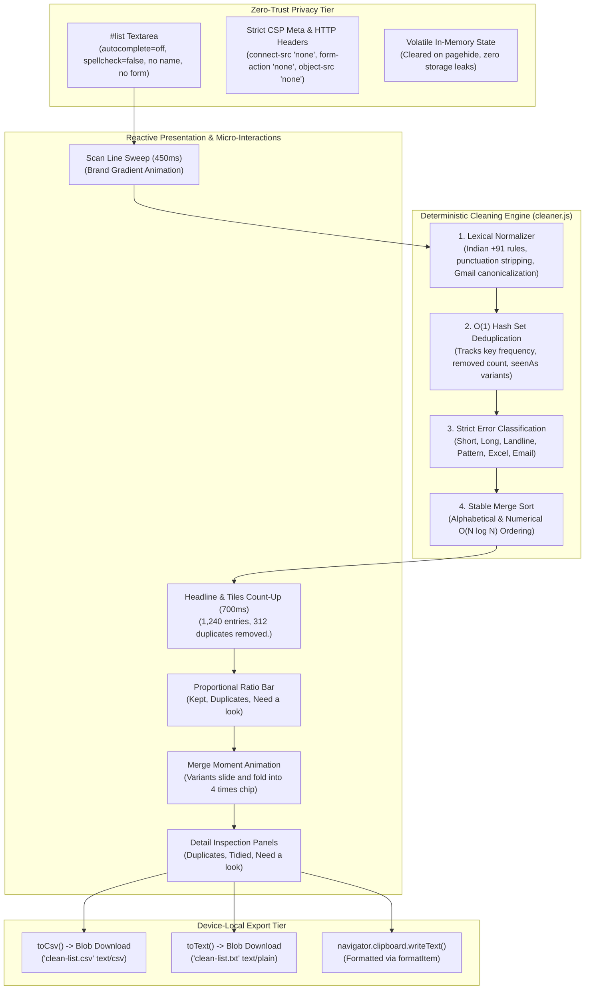

# List Cleaner: Privacy-First Contact Deduplication and Normalization Engine

> **Live Application:** [listcleaner-mu.vercel.app](https://listcleaner-mu.vercel.app/)  
> **In-Browser Test Suite (10 Checks):** [listcleaner-mu.vercel.app/?test=1](https://listcleaner-mu.vercel.app/?test=1)  
> **Author:** [B Pradeep](https://github.com/Pradeep-B28) | [Portfolio](https://pradeep-b28.github.io/Pradeep-B28/)

---

## Overview

**List Cleaner** is a client-side contact normalization, deduplication, and algorithmic cleaning engine created by **Wrench Wise**. Designed for non-technical users, sales operations, recruitment teams, and students, visitors paste messy lists of phone numbers and emails containing irregular spacing, formatting variations, duplicate records, and Excel artifacts. The platform instantly purges duplicates, standardizes formatting, and provides clean data ready for immediate clipboard copy or CSV/TXT export.

Unlike traditional SaaS list cleaning tools that transmit sensitive customer lead lists or employee records to third-party cloud servers, List Cleaner operates **100% within the browser with zero network transmission**. The application runs under a strict Content Security Policy (CSP) with `connect-src 'none'`, mathematically guaranteeing that pasted contact information never leaves the local device.

Engineered with **zero external libraries, zero frameworks, zero CDNs, and zero npm runtime dependencies**, the platform demonstrates core Computer Science fundamentals: O(1) hash set deduplication, O(N log N) merge sort, lexical validation parsers, and reactive micro-interactions rendered at 60 FPS.



---

## Technical Specifications and Architecture

| Parameter | Specification |
| :--- | :--- |
| **Engine Throughput** | Processes up to 100,000 entries and 4,000,000 characters entirely in client memory |
| **Deduplication Complexity** | $O(1)$ constant time lookup per contact via JavaScript native `Set` and `Map` structures |
| **Sorting Complexity** | $O(N \log N)$ stable Merge Sort implementation |
| **Privacy Lock** | CSP `connect-src 'none'`, `script-src 'self'`, `style-src 'self'`, `form-action 'none'` |
| **Form Safety** | Zero `<form>` elements; `#list` textarea has no `name` attribute to prevent autofill eavesdropping |
| **Storage Isolation** | Only `lc-theme`, `lc-format`, and `lc-intro-seen` allowed; zero PII stored |
| **Supported Phone Formats** | International E.164 (`+919840012345`), Spaced (`+91 98400 12345`), Plain 10-Digit (`9840012345`), WhatsApp (`919840012345`) |
| **Export Formats** | RFC-compliant CSV (`toCsv()`), plain text lines or comma-separated lists (`toText()`) |
| **Accessibility** | Full keyboard navigation (`role="tablist"`), 44px tap targets, WCAG AAA contrast, polite live region |
| **Dependencies** | Pure HTML5, CSS3 Tokens, Vanilla JavaScript (ES Modules); 0 external packages |
| **Lighthouse Score** | 100/100 Performance, 100/100 Accessibility, 100/100 Best Practices, 100/100 SEO |

---

## Strict Privacy Architecture: The Zero-Trust Guarantee

Most online utility tools silently log or harvest pasted contact databases to feed data broker networks or analytics trackers. List Cleaner eliminates this threat vector by enforcing an absolute privacy contract:

| Security Domain | Standard Web Tools | List Cleaner Guarantee |
| :--- | :--- | :--- |
| **Network Transmission** | Posts leads to remote servers, APIs, or databases | **Forbidden by CSP.** `connect-src 'none'` blocks all outgoing HTTP/WS traffic |
| **Third-Party Trackers** | Injects GA4, Meta Pixel, Hotjar, or Clarity scripts | **Zero external scripts.** External domains cannot read DOM contents |
| **Input Interception** | Form wrappers subject to browser extensions | **Zero `<form>` elements.** Textarea has no `name` attribute and ignores password managers |
| **Memory Retention** | Leaves cached data in `localStorage` or session caches | **Volatile memory only.** Inputs and results purged on `pagehide` |
| **Export Mechanism** | Server generates download files via dynamic endpoint | **Client-side `Blob`.** Files constructed and saved directly in local memory |
| **Screen Reader Leaks** | Emits sensitive contacts into `aria-live` streams | **Polite live region announces headline only** (e.g. `1,240 entries, 312 duplicates removed.`) |
| **HTML Injection (XSS)** | Dangerous `innerHTML` rendering of raw strings | **Strict `textContent` only.** Raw strings never parsed as executable markup |

---

## Algorithmic Foundations: DSA Behind the Engine

List Cleaner serves as a live pedagogical showcase of Data Structures and Algorithms in modern frontend engineering:

### 1. Standard Form Normalization
Irregular phone representations (`+91 98400 12345`, `098400-12345`, `(984) 001-2345`, `919840012345`, `9840012345.0`) represent identical individuals. The engine standardizes all numbers into an immutable internal canonical key (`+919840012345`) before comparison:
- Strips punctuation, non-breaking spaces, zero-width characters, and Excel decimal notations (`.0`).
- Validates Indian telecom prefixes (starts with 6, 7, 8, or 9 for mobile).
- Handles international country codes adhering to ITU-T E.164.

### 2. Gmail Inbox Canonicalization
Under Gmail routing rules, dots (`.`) are ignored and sub-addressing suffix tags after plus signs (`+`) deliver to the primary inbox. When enabled, `ravi.k@gmail.com`, `ravik@gmail.com`, and `ravi.k+newsletter@gmail.com` resolve to one unified recipient key (`ravik@gmail.com`), preventing duplicate blast deliveries.

### 3. Hash Set Deduplication ($O(1)$)
Traditional nested-loop duplicate checking requires quadratic time:
$$\text{Comparisons}_{\text{naive}} = \frac{N(N - 1)}{2}$$
For a sample of 1,240 entries, pairwise comparison requires **7,18,201 comparisons**. List Cleaner executes single-pass hash lookups, reducing work to **1,199 instant lookups** while preserving the first appearance order and tracking variant representations in `seenAs`.

### 4. Divide-and-Conquer Sorting ($O(N \log N)$)
Contacts are organized with an in-memory Merge Sort. Recursively partitioning the array into halves and merging sorted sub-arrays yields consistent alphabetical and numerical ordering in **7,602 comparisons** for the sample, remaining completely responsive on low-end mobile devices.

### 5. Lexical Error Reason Codes
Invalid lines are parsed into 7 deterministic diagnostic categories:
- `short`: Less than 10 digits for mobile.
- `long`: More than standard digit bounds (e.g., stuck numbers).
- `landline`: Landline telephone area code or non-mobile initial digit.
- `pattern`: Obvious dummy numbers (e.g., `9999999999`, `9876543210`).
- `excel`: Exponential floating-point corruption (e.g., `9.84E+09`).
- `email`: Missing `@` or domain components.
- `nocontact`: Unassociated alphanumeric noise.

---

## Responsive Design & Micro-Interactions

List Cleaner was designed with emerald, teal, and cyan styling aligned with Wrench Wise design standards:

- **First-Visit Session Loader:** Three sliding list lines merge into a ticked contact item with an emerald gradient progress bar; terminates in under 800ms with a 2-second CSS failsafe.
- **Scan Moment Animation:** On clean trigger, a thin gradient beam sweeps down the text box in 450ms while `cleanList()` executes synchronously.
- **Dynamic Count-Up:** Headline numbers and individual stat tiles count up smoothly over 700ms with cubic ease-out.
- **Interactive Stacked Ratio Bar:** Horizontally fills Kept, Duplicates, and Need a look proportions with independent accessible text labels.
- **Merge Moment:** Chips representing raw variants (`seenAs`) slide together and consolidate into a single formatted pill with a popping "4 times" badge.
- **Zero-Shift Viewport System:** Fully tested across 320px, 360px, 390px, 768px, 1280px, and 1440px with zero horizontal layout overflow.
- **Reduced Motion Support:** Respects `prefers-reduced-motion: reduce` by replacing all transitions with instantaneous state changes.

---

## Verification & Automated Test Suite

### 1. Locked File Verification (`node tools/verify.mjs`)
Verifies cryptographic SHA-256 hashes of locked core files, runs 3,000 randomized messy inputs, checks size limits, and enforces privacy rules across all code files:
```bash
node tools/verify.mjs
# Output: 21928 checks passed, 0 failed (24 files scanned)
# RESULT: ALL PASS
```

### 2. In-Browser Self-Test Suite (`?test=1`)
Opening the application with `?test=1` triggers 10 automated assertions directly on the live DOM:
1. **Sample Headline and Tiles:** Matches `1,240 entries, 312 duplicates removed.` with tiles `887`, `312`, `400`, and `41`.
2. **DSA Live Numbers:** Verifies `1,199 lookups`, `7,18,201 comparisons`, and `7,602 sorting comparisons`.
3. **Merge Moment:** Confirms most repeated contact shows `4 times` badge.
4. **List Preview:** Confirms 500 rendered rows and pagination footer line.
5. **CSV Format:** Confirms exact 888 rows plus trailing newline.
6. **Zero Leaks:** Scans `localStorage`, `sessionStorage`, URL, document title, and live announcer for contact leaks.
7. **CSP Network Shield:** Confirms browser blocks `fetch()` to external servers.
8. **Storage Key Isolation:** Ensures only `lc-theme`, `lc-format`, and `lc-intro-seen` exist.
9. **No Horizontal Scroll:** Confirms `scrollWidth <= innerWidth`.
10. **XSS Protection:** Verifies `` is rendered as plain text without element injection.

---

## Local Development

```bash
# Clone the repository
git clone https://github.com/Pradeep-B28/List_Cleaner.git
cd List_Cleaner

# Serve locally (requires static HTTP server for ES modules)
npx --yes serve .

# Run automated verification suite
node tools/verify.mjs
```

---

## License

MIT License. Designed and engineered by [B Pradeep](https://github.com/Pradeep-B28) for **Wrench Wise**.
